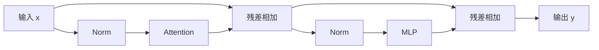

# L03｜现代 Transformer：从结构到训练稳定性

> Spring 2026 · 中文教材初版。主要依据用户提供的 `lecture-03.txt`，并结合[官方 PDF](https://github.com/stanford-cs336/lectures/blob/de53a9f979a6ee35f7d13a5e1aadee5ea1afc58e/lecture_03.pdf)。 时间定位：00:06–约 40:00 结构；约 45:00–64:00 超参数；65:02–89:07 稳定性与高效 Attention。 课件重点页：10–18、22–35、37–56、58–66（PDF 页码从 1 开始）。正文按知识逻辑重组，不是逐字翻译；“补充理解”与教学算例为作者解释。未逐句对照录音。

## 1. 先看一个完整的 decoder block

令输入隐藏状态为 `x[B,T,d]`。常见的串行 pre-norm block 可以写成：

$$
u=x+\mathrm{Attention}(\mathrm{Norm}(x)),\quad y=u+\mathrm{MLP}(\mathrm{Norm}(u)).
$$

这里有两条支路：残差流负责保留和累积已有表示，Attention 负责让不同位置交换信息，MLP 则对每个位置进行特征变换。多层重复后，最后一层隐藏状态通过输出矩阵产生词表 logits。

理解结构不能只问“哪种组件最好”，还要同时问表达能力、训练稳定性与硬件效率。一个在论文上稍好、却难稳定训练或难高效执行的结构，不一定是预算内的最佳选择。

## 2. 为什么 pre-norm 改变了梯度路径

post-norm 的写法是 `Norm(x + F(x))`；pre-norm 则是 `x + F(Norm(x))`。后者让残差流在每个 block 中保有一条更直接的加法通道，梯度不必层层穿过归一化的导数才能传回。

这提供了稳定深层训练的直觉，但不是“使用 pre-norm 就不需要 warmup”的保证。初始化、深度、学习率和优化器仍会相互作用。课程也讨论把归一化放在残差分支出口等变化，应分清“归一化分支”和“归一化整个残差和”。

## 3. RMSNorm、LayerNorm 与显存读写

对 d 维向量 x，LayerNorm 通常减均值并按方差归一化；RMSNorm 只按均方根缩放：

$$
\mathrm{RMSNorm}(x)_i=\gamma_i\frac{x_i}{\sqrt{\frac1d\sum_jx_j^2+\epsilon}}.
$$

不要漏掉均值中的 (1/d)，否则尺度会随维度变化。减少均值计算和 bias 等小操作，FLOPs 看起来很少，却可能减少数据移动、同步或 kernel 启动，因此仍会影响运行时间。这正是上一讲“FLOPs 不等于耗时”的具体例子。

**补充理解：** 归一化像自动音量调节，让信号在后续变换里保持合适尺度。但它会改变信号，应该放在哪里是架构问题，而不是随手添加的数值补丁。

## 4. SwiGLU 为什么有三个矩阵

普通 MLP 为 `activation(xW1)W2`，参数量约 (2df)。SwiGLU 则引入一个逐元素门：

$$
\mathrm{SwiGLU}(x)=\left[\mathrm{SiLU}(xW_g)\odot(xW_u)\right]W_d,
$$

其中 ​SiLU(z)=z·sigmoid(z)。两个 d→f 投影分别生成门和值，再通过 f→d 投影回去，因此参数量约 (3df)。

为了与普通 `f=4d` 的 MLP 参数量相近，需要 (3df=8d^2)，即 (f\approx8d/3)。所以“现代 MLP 的中间宽度约 2.67d”不是随意变窄，而是匹配三个矩阵的预算。

门控可以理解为“这个特征有多强”与“此时该不该让它通过”的乘法交互。但这种解释只是直觉；真实隐藏维度不一定对应可命名的人类概念。

## 5. RoPE 如何让位置差进入点积

把 Query 和 Key 的维度两两配对，并按位置旋转。对一对坐标，位置 p 的旋转矩阵是：

$$
R(p\omega)=\begin{bmatrix}\cos(p\omega)&-\sin(p\omega)\\\sin(p\omega)&\cos(p\omega)\end{bmatrix}.
$$

旋转后 (q'_p=R(p\omega)q_p)、(k'_r=R(r\omega)k_r)，于是：

$$
q_p'^\top k_r'=q_p^\top R((r-p)\omega)k_r.
$$

位置通过差值 r−p 影响 Attention，而不是只靠输入处加一个绝对位置向量。不同坐标对使用不同频率，形成多个尺度的位置变化。

这并不自动保证无限长度外推：训练中见到的相位分布、频率设定和上下文范围仍然重要。实现时要检查旋转维度的配对方式、位置偏移和 KV cache 的一致性。

## 6. 超参数规则是起点，不是定律

课堂比较很多模型，发现宽度、层数、头数和词表大小存在常见取值，但也有大量例外。`h*d_h=d` 是很常见的工程选择，不是 Attention 数学的必要条件；更深模型需要更多顺序执行，延迟和流水并行更难安排；更宽模型可能更容易形成大矩阵，但参数和显存也增加。

词表要平衡多语言覆盖、序列长度与输出层大小。dropout 和 weight decay 也不能只按“小数据集防过拟合”的直觉理解：大量单遍预训练中，weight decay 还会改变参数尺度和优化动力学。应把预训练、微调和小样本训练分别讨论。

## 7. 从 softmax 看稳定性

稳定 softmax 会先减去最大 logit，避免直接指数溢出。数学结果不变，但数值更可靠。QK norm 则控制进入 Attention softmax 的 Query/Key 尺度；logit soft-capping 用平滑函数限制极大值；z-loss 一类方法约束 log-partition 的漂移。

这些方法处理的问题不同。减最大值是数值等价变换，soft-capping 则真的改变函数，可能改变模型行为和高效 kernel 的适配。不要把所有方法都叫作“防溢出”而忽略差异。

## 8. 架构为什么开始为推理省内存

MHA 的每个 Query head 都有对应 K/V head。MQA 把 K/V 缩成共享的一组，GQA 则让若干 Query head 共享同一组 K/V。它们减少 KV cache 容量和读取量，特别适合生成时的逐 token 解码。

局部窗口 Attention 限制每个位置可读取的历史范围，减少计算和缓存需求；穿插全局 Attention 层则帮助长距离通信。节省成本意味着改变信息访问结构，需要同时评估长程任务。

## 深入算例与补充理解

### 让四个位置手算一次因果 Attention

对某个 Query，假设与四个 Key 的分数全为 0，该 Query 位于第二个位置。因果 mask 应允许位置 1、2，屏蔽 3、4，所以 softmax 后为 `[1/2,1/2,0,0]`。若 V 是四个标量 `[2,6,100,100]`，输出应是 4，而不是 52。

这个算例能抓住常见错误：mask 的三角方向反了；遮罩加成 0 而不是 −∞；softmax 归约维度错了；在训练标签上错位。大模型输出“看起来有点正常”，并不能替代这种小输入检查。

### 一个 block 的参数如何拆账

对标准 MHA，Q、K、V、O 四个投影各近似 d²；普通 MLP 的上/下投影共 2df。因此一层近似 `4d²+2df`。换成 SwiGLU 则是 `4d²+3df`。加入 GQA 后 K/V 投影的输出宽度减少，应重新计算，不能继续套 4d²。

例如 d=512、f=2048，普通 MLP 为 2,097,152 参数，Attention 为 1,048,576。MLP 已经占主要部分。多头划分本身通常只是改变投影结果的组织方式，不是把一份 d×d 投影变成 h 份同样大小的 d×d 投影。

### 为什么 Attention 要除以根号 d_h

假设 q 和 k 的各维近似独立、均值 0、方差 1，点积是 d_h 个乘积之和，方差随 d_h 增长。除以 √d_h 可让初始分数方差保持相近量级，减轻 softmax 过早饱和的风险。

这是初始化附近的直觉，不保证训练后各维仍独立。QK norm 等方法进一步直接控制向量尺度；它与固定的 √d_h 缩放有联系，但二者不应被看成完全重复。

### 把错误分成结构错误和优化问题

结构错误往往能在极小张量上发现，例如输出维度、残差维度、mask 和位置索引；优化问题则需要观察训练中的损失、梯度与激活，例如学习率过大、归一化实现不正确或初始化尺度不合适。

推荐顺序是先验证形状与因果性，再让小模型过拟合一个固定 batch，最后测试更一般数据。如果连固定 batch 都拟合不了，先不要急着归因于模型容量或数据质量。

## 9. 自测与设计练习

- d=768，普通 MLP 的 f=3072；参数匹配的 SwiGLU 应选多大的 f？为何硬件实现可能再取整？
- 用二维向量验证 (R(a)^\top R(b)=R(b-a))。
- 32 个 Query head 改为 8 个 KV head，其他条件相同，KV cache 理论上缩小多少？
- 为什么“RMSNorm 少一些 FLOPs”不是其加速效果的充分解释？

**参考思路：** f=2048；cache 约缩到四分之一；实际速度还取决于访存、融合和算子启动。每个结论都应附结构与测量前提。

## Transcript 对照补遗

### 初版压缩掉的架构选择（约 12:00–43:00）

“把归一化移出残差主干”不等于只有 pre-norm 一种形式：可在分支入口、出口或两处都归一化。不要把分支出口的 norm 与 `Norm(x+F(x))` 混为一谈。删除线性层 bias、用 RMSNorm 替换 LayerNorm，主要依据大量实验和系统效率，并非理论证明任何任务都不需要偏置。课堂所举“归一化 FLOPs 很少但耗时可观”的极端数字来自特定小模型，不能套到所有训练。

另一种结构把 Attention 与 MLP 并行：`y=x+Attention(Norm(x))+MLP(Norm(x))`。它可共享输入归一化、融合投影、缩短依赖链；串行结构中 MLP 则能立即使用 Attention 更新后的表示。课堂问答指出，不同报告对质量损失的结论并不一致，不能把某份报告中的系统收益当成普遍收益。

RoPE 之外，课堂还对比绝对位置向量、加到 attention 分数上的相对偏置（如 ALiBi 类方案）以及部分维度旋转。RoPE 的特色是把相对位置关系分解到两个向量的内积；不满足这个形式不代表别的方法不能工作。旋转通常作用于每层的 Q/K，不是 V；文字稿中的口述混淆不能照搬。无位置编码的 attention 在未加其他结构时对位置重排具有相应等变性，因果 mask 本身也会引入结构，因此“完全不知道位置”需要限定语境。

### 超参数的具体范围与课堂问答（约 43:00–65:00）

普通 MLP 中间宽度常取约 4d，参数匹配 GLU 常取约 8d/3，一些模型选择约 3.5d。早期 T5 的大倍率是课堂反例：可以训练成功，不代表预算效率最好。头数乘头维度约等于 d、宽度/层数约在 100 附近，也是课堂观察到的常用起点，而非最优性定理。很多超参数存在较宽的良好区间；真正部署时还要看矩阵形状与通信是否合适。

词表的历史对比是单语常见约 30k、多语常见约 100k–200k，表达的是所调查模型的趋势。比较 tokenizer 时，在**相同、未删改的原始字节串**上，用自然对数 NLL 除以 `字节数×ln2` 得到 bits per byte，避免 token 单位不同的干扰；还要统一规范化、文档边界和特殊符号约定。它是确定编码序列的编码长度比较，不能忽略不同 tokenizer 的预处理差异。

单遍训练也可能出现重复、污染或记忆，不能把讲者“过拟合不突出”的优化直觉理解成保证。Weight decay 与学习率衰减共同影响轨迹，可能改善训练损失而非仅缩小训练/验证差距；架构参数通常固定，weight decay 等训练超参数则可以随过程调节。扩散模型的最优架构问题在课堂中没有得到确定回答，应保留这个未知。

### 稳定性与推理的补充边界（约 65:00–结尾）

输出 z-loss 可写成 `λ(log Σexp(z_i))²`，约束 log-partition 漂移。Softmax 对所有 logit 同加常数不变，这提供了调整整体偏移的自由度；z-loss 也不能替代稳定的 log-sum-exp 实现。Attention soft-capping 常写为 `c·tanh(z/c)`，改变可表达的尖锐程度，课堂对比中单独使用可能降低质量。QK norm 控制输入尺度，仍不保证每个点积严格为 1。

KV cache 保存的是过去各层的 **Key 与 Value**，不是 Query，也不是整张 QK 分数矩阵；初版未展开的这处口述错误现明确纠正。MQA/GQA 也是训练时确定的架构，不能无代价地把已训练的 MHA 在推理时改成共享 KV。滑窗/全局混合与廉价递推层/全局 attention 混合，都是在长程信息访问与成本之间取舍；局部层的高层表示可间接带入更远的信息，但不等于每层都有全局直接读取能力。

---

[返回教材目录](README.md) · [材料与编写说明](../sources/textbook-evidence.md)

[上一讲：L02](02-pytorch-resource-accounting.md) · [下一讲：L04](04-linear-attention-moe.md)
