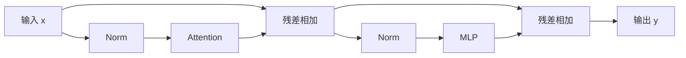

# L03｜现代 Transformer：从结构到训练稳定性

> Spring 2026。以用户提供的完整 lecture-03.txt 为主线，按课堂讨论顺序展开。结合[同年官方讲义](https://github.com/stanford-cs336/lectures/blob/de53a9f979a6ee35f7d13a5e1aadee5ea1afc58e/lecture_03.pdf)核对公式、图表与代码。未逐句回听音频。

本章只预设基本 Python、矩阵运算和概率/求导知识；第一次用到的课程术语在正文解释。课堂从标准 decoder 的组成进入归一化、门控与位置编码，再讨论超参数、数值稳定性和为推理改变的结构。

## 1. 先看一个完整的 decoder block

先把完整任务接起来。分词器（tokenizer）把文本片段映为整数 ID；词表大小为 V，embedding 表为 V×d，把 B 条、每条 T 个位置的输入变成 X[B,T,d]。B 是 batch 数，T 是序列长度，d 是残差向量宽度。decoder 是按因果方向处理这些表示的网络；最终输出投影把每个 d 维向量变成 V 个 logits，即候选 token 的未归一化得分。

Attention 的一头先做 Q=XW_Q、K=XW_K、V_h=XW_V。Query 表示“找什么”，Key 表示“可按什么匹配”，Value 是“匹配后取出的内容”；这些是计算角色，不要求向量对应可读的语义标签。设头宽为 d_h，分数 S=QKᵀ/√d_h，加因果遮罩后按每个 query 的 key 轴做 softmax，再计算 O=softmax(S+mask)V_h。遮罩把未来位置的分数置为 −∞，使其概率为零。

多头先各自算输出，再拼接并投影回 d；MLP 则对每个位置独立变换。残差是把分支输出加回原向量，要求相加的形状一致。训练位置 t 的表示预测下一 token；若标签没有正确右移，即使 mask 正确也会变成另一任务。

令输入隐藏状态为 `x[B,T,d]`。常见的串行 pre-norm block 可以写成：

$$
u=x+\mathrm{Attention}(\mathrm{Norm}(x)),\quad y=u+\mathrm{MLP}(\mathrm{Norm}(u)).
$$

这里有两条支路：残差流负责保留和累积已有表示，Attention 负责让不同位置交换信息，MLP 则对每个位置进行特征变换。多层重复后，最后一层隐藏状态通过输出矩阵产生词表 logits。

理解结构不能只问“哪种组件最好”，还要同时问表达能力、训练稳定性与硬件效率。一个在论文上稍好、却难稳定训练或难高效执行的结构，不一定是预算内的最佳选择。

## 2. 为什么 pre-norm 改变了梯度路径

Norm 是对单个位置的特征向量重新缩放。pre/post 描述它在计算图中的位置，不能只看名字判断梯度路径。对 y=x+F(Norm(x))，导数包含恒等项 I；对 y=Norm(x+F(x))，整体导数先乘归一化的 Jacobian。恒等项提供直接通路，但多层分支仍可放大或相互抵消，因此不是稳定性定理。

warmup 是训练开始时逐步增大学习率；学习率决定每次参数更新的尺度。比较归一化方案时必须同时说明是否 warmup，否则可能把训练配方差异归给架构。

post-norm 的写法是 `Norm(x + F(x))`；pre-norm 则是 `x + F(Norm(x))`。后者让残差流在每个 block 中保有一条更直接的加法通道，梯度不必层层穿过归一化的导数才能传回。

这提供了稳定深层训练的直觉，但不是“使用 pre-norm 就不需要 warmup”的保证。初始化、深度、学习率和优化器仍会相互作用。课程也讨论把归一化放在残差分支出口等变化，应分清“归一化分支”和“归一化整个残差和”。

### 归一化位置的其他选择

“把归一化移出残差主干”不等于只有 pre-norm 一种形式：可在分支入口、出口或两处都归一化。不要把分支出口的 norm 与 `Norm(x+F(x))` 混为一谈。删除线性层 bias、用 RMSNorm 替换 LayerNorm，主要依据大量实验和系统效率，并非理论证明任何任务都不需要偏置。课堂所举“归一化 FLOPs 很少但耗时可观”的极端数字来自特定小模型，不能套到所有训练。

### 如何读稳定性图

课件 p11 的横轴是训练进度，纵轴是验证损失或 BLEU；不同颜色/线型比较归一化位置与 warmup 设置。p12 则比较初始化时不同层的梯度范数和训练中的梯度尖峰。这两类图回答的是不同问题：前者看能否有效优化，后者帮助诊断梯度传播。它们支持在这些设置下采用 pre-norm，不能证明所有模型都不再需要 warmup。p52 的 loss 与梯度范数图也应一起看：平均 loss 下降并不能掩盖反复出现的梯度尖峰。

### 归一化分支不等于归一化残差流

p13 中 `x + Norm(F(x))` 仍然保有直接的 x 通路；`Norm(x+F(x))` 则把整个残差和送进 norm。双 norm 可以写成 `x + Norm_out(F(Norm_in(x)))`。因此，“post”必须说明是分支出口还是残差相加以后；只看名字容易把两种计算图混淆。

## 3. RMSNorm、LayerNorm 与显存读写

LayerNorm 先计算 μ=(1/d)Σx_i、σ²=(1/d)Σ(x_i−μ)²，再输出 γ_i(x_i−μ)/√(σ²+ε)+β_i。γ、β 是可学习缩放与偏移，ε 是避免零分母的小正数。下面的 RMSNorm 不减均值，使用的是均方根；“少一步”改变了函数，也改变实现中的读写与归约，不能只比较公式长度。

对 d 维向量 x，LayerNorm 通常减均值并按方差归一化；RMSNorm 只按均方根缩放：

$$
\mathrm{RMSNorm}(x)_i=\gamma_i\frac{x_i}{\sqrt{\frac1d\sum_jx_j^2+\epsilon}}.
$$

不要漏掉均值中的 (1/d)，否则尺度会随维度变化。减少均值计算和 bias 等小操作，FLOPs 看起来很少，却可能减少数据移动、同步或 kernel 启动，因此仍会影响运行时间。这正是上一讲“FLOPs 不等于耗时”的具体例子。

**补充理解：** 归一化像自动音量调节，让信号在后续变换里保持合适尺度。但它会改变信号，应该放在哪里是架构问题，而不是随手添加的数值补丁。

### 为什么少量 FLOPs 可以占很多时间

p15–16 引用实验中，张量收缩占 99.80% FLOPs、61.0% 时间；统计归一化占 0.17% FLOPs、25.5% 时间；逐元素操作占 0.03% FLOPs、13.5% 时间。这是说明**计算量占比和耗时占比不同**的例子。课堂在约 16–18 分钟特意说明，该例的模型/矩阵较小，比例很极端。它不意味着你的训练中 norm 一定占四分之一时间。

p17 的 RMSNorm 表还同时报告 steps/s、loss 和下游分数。改动可能改善速度，也可能在某些实验中改善质量；后者是经验结果，不是 RMSNorm 的数学保证。

## 4. SwiGLU 为什么有三个矩阵

MLP 在这里指两个线性投影夹一个非线性的前馈模块；f 为中间宽度。逐元素乘法 ⊙ 是同坐标相乘，sigmoid(z)=1/(1+exp(−z))，SiLU(z)=z·sigmoid(z)。三个矩阵的形状分别为 d×f、d×f、f×d，故输出还能与 d 维残差相加。

普通 MLP 为 `activation(xW1)W2`，参数量约 (2df)。SwiGLU 则引入一个逐元素门：

$$
\mathrm{SwiGLU}(x)=\left[\mathrm{SiLU}(xW_g)\odot(xW_u)\right]W_d,
$$

其中 ​SiLU(z)=z·sigmoid(z)。两个 d→f 投影分别生成门和值，再通过 f→d 投影回去，因此参数量约 (3df)。

为了与普通 `f=4d` 的 MLP 参数量相近，需要 (3df=8d^2)，即 (f\approx8d/3)。所以“现代 MLP 的中间宽度约 2.67d”不是随意变窄，而是匹配三个矩阵的预算。

门控可以理解为“这个特征有多强”与“此时该不该让它通过”的乘法交互。但这种解释只是直觉；真实隐藏维度不一定对应可命名的人类概念。

另一种结构把 Attention 与 MLP 并行：`y=x+Attention(Norm(x))+MLP(Norm(x))`。它可共享输入归一化、融合投影、缩短依赖链；串行结构中 MLP 则能立即使用 Attention 更新后的表示。课堂问答指出，不同报告对质量损失的结论并不一致，不能把某份报告中的系统收益当成普遍收益。

### 门控表格的证据边界

p24–25 比较的是控制参数预算的架构实验：门控多一个矩阵，所以缩小中间宽度后再比较。读表时先确认参数、计算量和指标方向相同，再看差值与波动。SwiGLU 并非每列第一；课堂的结论是门控变体整体表现有竞争力，并得到多个实验支持，而不是一种激活在所有任务上严格优于其他激活。

### 串行与并行的证据边界

p27–28 的并行 block 让 Attention 和 MLP 读取同一个输入，可共享 norm、合并输入投影；但 MLP 也不再读取本层 Attention 的更新结果。课件摘录的约 15% 加速属于 PaLM 的具体实现和规模。约 39–42 分钟的问答进一步承认：后续模型较少采用并行层只是间接信号，课堂没有给出足够受控的实验来量化普遍质量损失。“有效顺序深度减少”的说法是结构直觉，不能换算成固定的准确率损失。

## 5. RoPE 如何让位置差进入点积

位置 p、r 是序列中的整数索引，ω 是该坐标对的旋转频率。一个二维旋转不会改变向量长度；R(a)ᵀ=R(−a)，所以共同的绝对位移会在旋转后的点积中抵消。这个结论针对给定的旋转前 Q/K，不表示整网完全不含绝对位置线索。

把 Query 和 Key 的维度两两配对，并按位置旋转。对一对坐标，位置 p 的旋转矩阵是：

$$
R(p\omega)=\begin{bmatrix}\cos(p\omega)&-\sin(p\omega)\\\sin(p\omega)&\cos(p\omega)\end{bmatrix}.
$$

旋转后 (q'_p=R(p\omega)q_p)、(k'_r=R(r\omega)k_r)，于是：

$$
q_p'^\top k_r'=q_p^\top R((r-p)\omega)k_r.
$$

位置通过差值 r−p 影响 Attention，而不是只靠输入处加一个绝对位置向量。不同坐标对使用不同频率，形成多个尺度的位置变化。

这并不自动保证无限长度外推：训练中见到的相位分布、频率设定和上下文范围仍然重要。实现时要检查旋转维度的配对方式、位置偏移和 KV cache 的一致性。

RoPE 之外，课堂还对比绝对位置向量、加到 attention 分数上的相对偏置（如 ALiBi 类方案）以及部分维度旋转。RoPE 的特色是把相对位置关系分解到两个向量的内积；不满足这个形式不代表别的方法不能工作。旋转通常作用于每层的 Q/K，不是 V；文字稿中的口述混淆不能照搬。无位置编码的 attention 在未加其他结构时对位置重排具有相应等变性，因果 mask 本身也会引入结构，因此“完全不知道位置”需要限定语境。

### 位置编码的比较条件

p30–35 希望找到 `〈f(x,i), f(y,j)〉=g(x,y,i-j)` 的可分解内积形式。把位置向量加到词向量上会产生内容与位置的交叉项；RoPE 的共同平移则在点积中抵消。相对位置偏置、ALiBi 等方案不必满足这里选定的分解形式，也仍可能有效。约 42–43 分钟问答明确把这个要求视为设计约束，不能由“不是这种内积”推断“不是有效的位置方案”。

RoPE 的位置差性质针对给定的、旋转前的 Q/K；整个深层网络还可能通过因果边界等获取绝对位置信息。因此它不是整个语言模型任意平移都完全不变的证明。

## 6. 超参数规则是起点，不是定律

超参数是训练前或训练过程中由人设置的结构与优化选择，例如层数、宽度、学习率。dropout 在训练中随机屏蔽部分中间值；weight decay 对参数施加收缩更新，两者不等同。看到表中“头数×头宽≠d”不应先判错：Q/K/V 投影的总输出宽度可以独立选择，只是常见实现取成 d。

课堂比较很多模型，发现宽度、层数、头数和词表大小存在常见取值，但也有大量例外。`h*d_h=d` 是很常见的工程选择，不是 Attention 数学的必要条件；更深模型需要更多顺序执行，延迟和流水并行更难安排；更宽模型可能更容易形成大矩阵，但参数和显存也增加。

词表要平衡多语言覆盖、序列长度与输出层大小。dropout 和 weight decay 也不能只按“小数据集防过拟合”的直觉理解：大量单遍预训练中，weight decay 还会改变参数尺度和优化动力学。应把预训练、微调和小样本训练分别讨论。

### 超参数的具体范围与课堂问答

普通 MLP 中间宽度常取约 4d，参数匹配 GLU 常取约 8d/3，一些模型选择约 3.5d。早期 T5 的大倍率是课堂反例：可以训练成功，不代表预算效率最好。头数乘头维度约等于 d、宽度/层数约在 100 附近，也是课堂观察到的常用起点，而非最优性定理。很多超参数存在较宽的良好区间；真正部署时还要看矩阵形状与通信是否合适。

词表的历史对比是单语常见约 30k、多语常见约 100k–200k，表达的是所调查模型的趋势。比较 tokenizer 时，在**相同、未删改的原始字节串**上，用自然对数 NLL 除以 `字节数×ln2` 得到 bits per byte，避免 token 单位不同的干扰；还要统一规范化、文档边界和特殊符号约定。它是确定编码序列的编码长度比较，不能忽略不同 tokenizer 的预处理差异。

单遍训练也可能出现重复、污染或记忆，不能把讲者“过拟合不突出”的优化直觉理解成保证。Weight decay 与学习率衰减共同影响轨迹，可能改善训练损失而非仅缩小训练/验证差距；架构参数通常固定，weight decay 等训练超参数则可以随过程调节。扩散模型的最优架构问题在课堂中没有得到确定回答，应保留这个未知。

### 超参数图表怎么读

p40 在 50M 参数实验中画 FFN 宽度比与相对 loss 增加，低谷比较宽。p46 的宽深比实验也呈现一段相近表现的区域。实用含义是先选择合理范围，再考虑矩阵效率、显存和延迟；不能把小模型图中的最低点直接当成所有规模的最优值。T5 的 64 倍 FFN 是能训练的反例，不证明这样分配预算最划算。

### 核算表格，不照抄数字

p43 的 PaLM 行写有 48 个头、head dim 258、model dim 18432、ratio 1.48；这些数不满足表头所指的 `num_heads × head_dim / model_dim`：按所列数计算约为 0.672。这里保留为**课件内部不一致、具体配置待查**，不猜一个值替换。教学上只采用可直接验证的结论：头总宽度可以不同于残差宽度。教材算例必须自己算一遍。

### 词表与 bits per byte 问答

p47 与约 55–59 分钟讨论：扩大词表能缩短某些语言的序列，却会增加 embedding/输出层。多模态也可能有独立图像词表，并非所有模态都共用同一张词表。

跨 tokenizer 比较时，不能直接比较每 token perplexity。对同一份原始文本，可以报告 `BPB = −log₂ p(text) / 原始字节数`，前提是编码可逆、文本没有被删改，并且计算概率和边界处理的约定一致。固定 tokenizer 时，BPB 与平均 token NLL 通过该数据的 token/byte 比例换算；跨 tokenizer 时这个比例会变。课堂最后一段追问没有被完全解决，不替讲者补成确定结论。

### 如何读 weight decay 图

p50 左图把训练 loss 与验证 loss 对照，不同 weight decay 设置没有显示出典型的“训练更好、验证更差”的分离。右侧进一步对比 cosine 衰减与恒定学习率，说明 weight decay 与学习率计划会交互。因此，本例中的收益可能主要来自优化动力学。它不证明单遍训练绝不会记忆，也不证明所有任务中 weight decay 都与泛化无关。约 63–65 分钟关于 diffusion 最优架构的问题，讲者明确表示没有足够研究，教材同样不作结论。

## 7. 从 softmax 看稳定性

softmax(z)_i=exp(z_i)/Σ_jexp(z_j)。从所有 z 减同一个有限常数，分子分母会消去相同因子；选择最大值可避免直接指数溢出。QK norm 改的是计算分数的输入尺度，soft-cap 改的是分数函数，z-loss 改的是训练目标，三个动作应分别核算。

稳定 softmax 会先减去最大 logit，避免直接指数溢出。数学结果不变，但数值更可靠。QK norm 则控制进入 Attention softmax 的 Query/Key 尺度；logit soft-capping 用平滑函数限制极大值；z-loss 一类方法约束 log-partition 的漂移。

这些方法处理的问题不同。减最大值是数值等价变换，soft-capping 则真的改变函数，可能改变模型行为和高效 kernel 的适配。不要把所有方法都叫作“防溢出”而忽略差异。

### 稳定性与推理的补充边界

输出 z-loss 可写成 `λ(log Σexp(z_i))²`，约束 log-partition 漂移。Softmax 对所有 logit 同加常数不变，这提供了调整整体偏移的自由度；z-loss 也不能替代稳定的 log-sum-exp 实现。Attention soft-capping 常写为 `c·tanh(z/c)`，改变可表达的尖锐程度，课堂对比中单独使用可能降低质量。QK norm 控制输入尺度，仍不保证每个点积严格为 1。

### soft-capping 的质量代价

p56 的 `c·tanh(z/c)` 把 logits 限制在 (−c,c)，但会改变注意力分布，而非仅改进浮点求值。课件表中的单独 soft-cap 在该实验中 PPL 略差，QK norm 的结果更好。稳定性收益、表达限制和 kernel 适配成本要一起考虑；不能只写“加 cap 就更好”。

## 8. 架构为什么开始为推理省内存

自回归生成每次新增一个位置。过去位置因果上不会被未来改变，可保存每层的 Key、Value，这就是 KV cache；过去 Query 已完成自己的读取，不需要供未来查询使用。prefill 一次处理已知 prompt，decode 则逐位置生成。减少 KV 头能省缓存，但必须配合训练后的有效架构，不能随手删头。

MHA 的每个 Query head 都有对应 K/V head。MQA 把 K/V 缩成共享的一组，GQA 则让若干 Query head 共享同一组 K/V。它们减少 KV cache 容量和读取量，特别适合生成时的逐 token 解码。

局部窗口 Attention 限制每个位置可读取的历史范围，减少计算和缓存需求；穿插全局 Attention 层则帮助长距离通信。节省成本意味着改变信息访问结构，需要同时评估长程任务。

KV cache 保存的是过去各层的 **Key 与 Value**，不是 Query，也不是整张 QK 分数矩阵；这里明确区分这些缓存对象。MQA/GQA 也是训练时确定的架构，不能无代价地把已训练的 MHA 在推理时改成共享 KV。滑窗/全局混合与廉价递推层/全局 attention 混合，都是在长程信息访问与成本之间取舍；局部层的高层表示可间接带入更远的信息，但不等于每层都有全局直接读取能力。

### prefill 与 decode 的计账单位

p58–61 的 n 表示序列长度。p60 的 `O(bnd²)` 计算和 `O(bn²d+nd²)` 访存，是简化假设下**连续生成 n 步的累计量**，不是单步生成一个 token 的成本；投影的重复读权重产生 `nd²` 项。单步在已有 t 个历史 token 时，主要投影计算约 `O(bd²)`，读 KV 约 `O(btd)`，还要读权重。明确计账单位后，才能理解为什么训练的大矩阵很高效，而低 batch 解码可能受带宽限制。

### GQA 的质量与延迟图

p61 的“一组 KV”是每层共享一组 K/V **向量头**，并不是 K/V 都成为一个标量。p63 同时画下游分数与 time/sample：较理想的位置是质量高、耗时低；减少 KV 头会产生质量与效率取舍。图中 GQA 接近 MHA 的质量而更快，是具体实验结果，不能保证任意模型或分组数都没有损失。约 84 分钟问答确认，KV 头数属于训练架构；不是部署时直接删掉一些头就自动得到同样质量。

### 混合层中的信息传播

p64 的蓝色格子表示允许访问的位置，空白处被 mask；固定窗口与跨步稀疏模式不同。p65–66 又展示按层交替的全局与低成本模块。局部层可以读取前面全局层已经汇总的信息，因此“这一层只看局部”不等于“最终表示完全没有远处信息”。但这也不保证能保留任意长程细节。

NoPE、RoPE、滑窗和 gated delta 属于不同选择：位置编码、访问模式、序列混合算子应分开识别。课件中的 Qwen 混合图用了 gated delta 与全注意力，不能统一描述成所有模型都在交替滑窗与全注意力。

## 深入算例与补充理解

### 让四个位置手算一次因果 Attention

对某个 Query，假设与四个 Key 的分数全为 0，该 Query 位于第二个位置。因果 mask 应允许位置 1、2，屏蔽 3、4，所以 softmax 后为 `[1/2,1/2,0,0]`。若 V 是四个标量 `[2,6,100,100]`，输出应是 4，而不是 52。

这个算例能抓住常见错误：mask 的三角方向反了；遮罩加成 0 而不是 −∞；softmax 归约维度错了；在训练标签上错位。大模型输出“看起来有点正常”，并不能替代这种小输入检查。

### 一个 block 的参数如何拆账

对标准 MHA，Q、K、V、O 四个投影各近似 d²；普通 MLP 的上/下投影共 2df。因此一层近似 `4d²+2df`。换成 SwiGLU 则是 `4d²+3df`。加入 GQA 后 K/V 投影的输出宽度减少，应重新计算，不能继续套 4d²。

例如 d=512、f=2048，普通 MLP 为 2,097,152 参数，Attention 为 1,048,576。MLP 已经占主要部分。多头划分本身通常只是改变投影结果的组织方式，不是把一份 d×d 投影变成 h 份同样大小的 d×d 投影。

### 为什么 Attention 要除以根号 d_h

假设 q 和 k 的各维近似独立、均值 0、方差 1，点积是 d_h 个乘积之和，方差随 d_h 增长。除以 √d_h 可让初始分数方差保持相近量级，减轻 softmax 过早饱和的风险。

这是初始化附近的直觉，不保证训练后各维仍独立。QK norm 等方法进一步直接控制向量尺度；它与固定的 √d_h 缩放有联系，但二者不应被看成完全重复。

### 把错误分成结构错误和优化问题

结构错误往往能在极小张量上发现，例如输出维度、残差维度、mask 和位置索引；优化问题则需要观察训练中的损失、梯度与激活，例如学习率过大、归一化实现不正确或初始化尺度不合适。

推荐顺序是先验证形状与因果性，再让小模型过拟合一个固定 batch，最后测试更一般数据。如果连固定 batch 都拟合不了，先不要急着归因于模型容量或数据质量。

## 独立完成一个小算例

取两个允许读取的位置，缩放后的分数为 [0,ln3]，值为 [2,6]。softmax 权重为 [1/4,3/4]，输出是 0.25×2+0.75×6=5。若第三个位置属于未来，应在归一化前遮住；将它当成一个分数为 0 的普通候选会改变前两个权重。这个例子把打分、归一化、取值和因果性完整连在一起。

## 9. 自测与设计练习

- d=768，普通 MLP 的 f=3072；参数匹配的 SwiGLU 应选多大的 f？为何硬件实现可能再取整？
- 用二维向量验证 (R(a)^\top R(b)=R(b-a))。
- 32 个 Query head 改为 8 个 KV head，其他条件相同，KV cache 理论上缩小多少？
- 为什么“RMSNorm 少一些 FLOPs”不是其加速效果的充分解释？

**参考思路：** f=2048；cache 约缩到四分之一；实际速度还取决于访存、融合和算子启动。每个结论都应附结构与测量前提。

### 逐题推理

1. 普通 MLP 为 2df=8d²；SwiGLU 为 3df，令两者相等，d=768 时 f=8d/3=2048。硬件常偏好某些对齐尺寸，取整后需重新检查实际参数量。
2. R(a)ᵀ=R(−a)，二维旋转复合满足 R(u)R(v)=R(u+v)，相乘即得到 R(b−a)。
3. 固定层数、序列长、头宽和 dtype，KV 大小随 KV 头数线性变化；32→8 为四分之一，Query 头数不因此自动变成 8。
4. 归一化即使 FLOPs 少，也可能读写整个激活并产生归约和启动成本。是否加速必须检查实际融合和模型规模。

---

[返回教材目录](README.md) · [材料与编写说明](21-jiao-cai-cai-liao-yu-bian-xie-shuo-ming.md)

[上一讲：L02](03-l02-ba-zhang-liang-xian-cun-he-flops-suan-ming-bai.md) · [下一讲：L04](05-l04-zhang-shang-xia-wen-yu-moe-gai-bian-ji-suan-de-zu-zhi-fang-shi.md)
