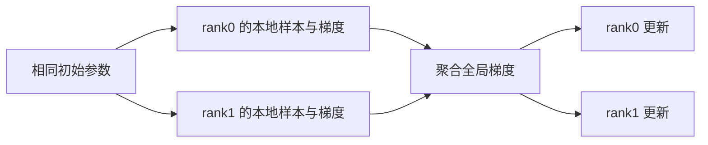

# L07｜多 GPU 的语言：集合通信与三种基本并行

> Spring 2026 · 中文教材（含 Transcript 对照补遗）。主要依据用户提供的 `lecture-07.txt`，并结合[官方 课堂代码](https://github.com/stanford-cs336/lectures/blob/de53a9f979a6ee35f7d13a5e1aadee5ea1afc58e/lecture_07.py)。 时间定位：00:05–约 30:03 原语与硬件；约 35:00–50:00 通信示例；55:01–80:54 三种并行。正文按知识逻辑重组，不是逐字翻译；“补充理解”与教学算例为作者解释。未逐句对照录音。

## 1. 多卡解决两个问题

第一种情况是模型、梯度、优化器状态和激活装不进一张卡；第二种情况是能装下，但训练太慢。增加 GPU 可能解决容量问题，却未必提高速度，因为设备之间需要交换数据。

单卡优化在寄存器、片上存储与 HBM 之间安排数据；多卡优化把同样的问题延伸到互联网络。最重要的不是“有多少张卡”，而是每个阶段计算什么、拥有哪份数据、需要等待谁。

## 2. Rank、进程组与通信顺序

rank 是进程组中的编号，world size 是组大小。常见训练方式是一张 GPU 对应一个进程，但 rank 本质上是组内进程标识，不是永远固定的物理设备编号。

所有参与同一 collective 的 rank 必须遵守一致的调用顺序和兼容的张量约定。例如一张卡执行 all-reduce，另一张却进入 all-gather，可能一直等待。调试分布式程序时，先检查控制流和参与组，再怀疑网络速度。

## 3. 用两个数组记住通信原语

假设 rank0 有 `[1,2]`，rank1 有 `[10,20]`：

| 操作 | 结果直觉 |
| --- | --- |
| Broadcast | 指定来源的一份数据复制给所有 rank |
| Gather | 各 rank 的数据拼到一个目标 rank |
| All-gather | 每个 rank 都得到 `[1,2,10,20]` |
| Reduce(sum) | 一个目标 rank 得到 `[11,22]` |
| All-reduce(sum) | 每个 rank 都得到 `[11,22]` |
| Reduce-scatter(sum) | 先求和，再让 rank0 得 `[11]`、rank1 得 `[22]` |
| All-to-all | 每个 rank 向每个其他 rank 发送各自的一部分 |

reduce-scatter 后再 all-gather，可以实现相同语义的 all-reduce。它们的区别不只是命名，而是最终数据的所有权：完整复制，还是每人持有一片。这会直接决定显存使用。

All-to-all 常用于 MoE，因为 token 原本按数据分布，专家却按设备分布；必须把 token 搬到专家所在处，再把结果还回去。

## 4. 通信为什么有启动成本和带宽成本

一个简化模型是 `时间 ≈ 启动次数 × α + 字节数 / 有效带宽`。小消息常被 α 主导，大消息更接近带宽上限。网络拓扑、链路共享、拥塞和 collective 算法都会影响有效值。

对 P 个 rank、每个 rank 具有 S 字节数据的理想 ring all-reduce，每 rank 发送量约为 (2(P-1)S/P)。但这不是所有网络算法的通用耗时公式，也不能把聚合带宽误当成一条物理链路的带宽。

节点内 NVLink 等互联通常更快，跨节点链路更慢；具体系统可能使用 InfiniBand、RoCE 或其他网络。不能简单说“Ethernet 永远不能直接访问显存”：是否使用 RDMA、网卡和软件配置都重要。

## 5. 数据并行：复制模型，划分样本

每张卡保存相同参数，处理不同数据，计算本地梯度，然后聚合梯度并执行相同更新。只要初始参数一致、更新一致，模型副本就保持一致。

两卡各处理等量样本时，本地平均梯度分别为 g0、g1，全局平均是 `(g0+g1)/2`。如果有效 token 数不同，就必须按 token 数加权；直接平均两个局部均值，会改变训练目标。

DDP 通常用 all-reduce 同步梯度。它增加计算能力，但原始复制式 DDP 没有解决每卡模型状态过大的问题。梯度聚合还应与梯度裁剪、混合精度缩放和梯度累积的顺序配合。

## 6. 张量并行：分一层的矩阵

设 (Y=XW)。若按 W 的输出列切分，各卡分别计算输出的一部分，可以拼成完整 Y。若按输入行切分，需要同时切 X，每张卡得到一个局部贡献，最后求和。

两层 MLP 可以将第一层按列切、第二层按行切，中间的逐元素激活在每张卡本地完成，减少中途通信。它的代价是几乎每层都需要交换激活，因此适合低延迟、高带宽互联。

**补充理解：** 数据并行是“每家工厂都有一整条生产线，各接不同订单”；张量并行是“一道工序由几个车间共同完成”。后者必须频繁交接半成品。

## 7. 流水并行：按深度拆模型

把前几层放一张卡、后几层放另一张卡，只传相邻阶段的激活和反向梯度。如果一次只处理一个 batch，很多卡会等待。因此要拆成 microbatch，让不同阶段同时工作。

流水并行不是完全独立训练几个子模型。误差信号仍必须沿整个计算图返回，所有参数更新的时序也要一致；否则会引入参数陈旧等不同训练语义。

## 8. 验证顺序比直接跑大集群更重要

先在单进程参考实现上固定参数与输入；再检查两卡前向相同、梯度相同、一步更新后参数相同；最后测吞吐。随机种子要区分“需要复制一致的初始模型”和“希望不同 rank 得到的不同样本”。

通信微基准应该预热、同步并覆盖消息大小。不要用打印顺序判断 rank 的逻辑先后：并发输出本来就可能交错。

## 深入算例与补充理解

### 两个 rank 的一步训练怎样证明等价

假设单卡损失是四个样本损失的平均。把前两个给 rank0、后两个给 rank1，两边各自对两个样本取平均，再把两个梯度平均，得到的就是四样本平均梯度。于是相同参数、相同优化器状态下，一步更新应与单卡参考一致，除浮点归约误差外。

若 rank0 有一个有效 token、rank1 有三个，直接平均两个局部均值则分别给予两边一半权重，变成第一个 token 权重 1/2，其余各 1/6。正确的全局平均应该各为 1/4。这个算例解释了 padding、动态 batch 和不同序列长度为什么会让分布式 loss 处理出错。

### 归约可以重排，程序副作用不能任意重排

在理想实数加法下，reduce-scatter 加 all-gather 等于 all-reduce；浮点归约顺序不同，结果会有舍入差异。若每个 rank 在聚合前分别裁剪梯度，还可能出现更大且有语义意义的差异，因为“先裁剪再平均”不等于“先平均再裁剪”。

类似地，各 rank 分别更新 Adam 后再平均参数，一般不等于先平均梯度再进行同一个 Adam 更新。Adam 的平方、归一化与状态更新是非线性的。分布式等价性必须围绕完整更新公式，而不是只看参数最后是否同步。

### 张量切分的一个数值小例子

设 X=[1,2]，W 的两行分别为 `[3,4]`、`[5,6]`，则 Y=[13,16]。按输出列切，两个 rank 分别得到 13 和 16，拼接即可；按输入维切，则分别得到 `[3,4]` 与 `[10,12]`，需要相加。

这两个切法的“输出是分片还是部分和”不同。把需要求和的结果直接拼接，是非常典型的 TP 错误。做两层 MLP 时，应顺着中间激活的所有权安排下一层矩阵切法。

### 通信日志应该记录什么

对每个 collective 记录进程组、张量 shape、dtype、操作类型与阶段编号；必要时只打印摘要，避免大量日志改变时序。发生 hang 时先查各 rank 是否进入同一步，不能用一张卡的正常日志代表全组。

然后再测 latency/bandwidth regime 和拓扑边界。单机两卡通过的逻辑，不意味着跨节点无需配置初始化、网络接口、超时与故障恢复。

## 9. 自测

- 为什么 all-reduce 的结果需要说明 sum 还是 mean？
- reduce-scatter 的结果为什么适合分片优化器？
- 单卡 batch 为 8，两卡各 8，等价的是原来的 batch 8 还是 16？
- 什么条件下增加第九张卡，收益可能比增加第八张卡小得多？

**参考思路：** 看全局有效 batch 和拓扑边界；跨节点通信可能让新增计算收益被同步开销抵消。

## Transcript 对照补遗

> 核验进行中：无时间戳续行尚需补做完整对照，本补遗不是无遗漏认证。

### 网络拓扑不是一根统一的“网线”（00:00–约 36:00）

本讲无时间戳续行尚需补做完整对照，以下保留本轮已检查的通信语义和训练流程。课堂的层级是片上存储→HBM→NVLink/NVSwitch 域→跨节点网络，越远通常越贵；并非所有集群都严格采用同一种层级。较大的 NVLink 域、InfiniBand、Ethernet 和 RoCE 都是具体配置选项。

RDMA 描述远端直接内存访问能力，InfiniBand 和 RoCE 是实现相关网络路线，不能把 RDMA 当成另一种与它们平行的线缆。实际 GPU 直连传输还取决于设备、驱动和 GPUDirect 等路径。NCCL 把 collective 映射到拓扑和通信算法；PyTorch distributed 提供接口，初始化时的协调连接不等于训练张量都经由该连接传送。

Broadcast 是把某 rank 的张量复制出去，不是 NumPy 广播维度；gather 拼接，reduce 逐元素聚合，all 表示结果分发到所有相关 rank。All-to-all 的均衡等大小示例像转置，MoE 动态路由则可能需要不同的发送/接收分片大小。All-reduce 可分解为 reduce-scatter + all-gather，这是语义分解，不保证底层总采用相同的环算法。

### 通信性能的数字要说清口径（约 36:00–55:00）

设每 rank 参与 all-reduce 的完整张量为 S bytes、world size 为 p，在理想 ring 模型中每 rank 传送约 `2(p−1)S/p` bytes；reduce-scatter 约为 `(p−1)S/p`。除以通信耗时得到常见校正带宽口径，不能把跨 rank 求和后的总字节数与单链路规格直接比较。实际选用算法、双向规格、层级与小消息延迟都会改变解释。

测量应处理两种异步：不同进程的进度，以及各设备提交/完成的进度。Barrier 与设备同步用途不同；`async_op` 返回工作句柄，调用方须在依赖结果前正确等待，并遵守 stream 依赖。不能为了“加速”在尚未完成的通信张量上直接计算。汇总时关注最慢 rank，而不是只挑最快记录。

### 教学代码能说明什么，不能自动完成什么（约 55:00–结尾）

DDP 在各 rank 的不同样本上前向/反向，再平均梯度；保持同样初始化和更新，模型副本才一致。普通 tensor-parallel 示例把列切分结果 all-gather，涉及通信的反向还需要匹配的梯度传播；不能仅调用任意原始 collective 后就假定 autograd 自动齐全。

流水并行示例用点对点 send/recv 传递 microbatch 激活，真实训练还需反向梯度、正确顺序与缓冲生命周期。非阻塞传输与反向就绪即发送的梯度 bucket，可以把通信藏在计算后，但要付出更细的依赖管理。TP 一般需要更紧密的低延迟网络，PP 较能容忍较慢链接，DP 的扩展则还受全局 batch 和临界 batch 限制。具体方案应根据拓扑选择，不能无限添加卡而假定等比例加速。

课堂最后对比“手工安排 collective”与“声明张量分片、由编译器插入通信”：后者降低开发负担，前者帮助理解机制。两者都在重复存储/计算与数据移动之间做交换。

---

[返回教材目录](README.md) · [材料与编写说明](21-jiao-cai-cai-liao-yu-bian-xie-shuo-ming.md)

[上一讲：L06](07-l06-cong-pytorch-dao-triton-ce-liang-rong-he-yu-fen-kuai.md) · [下一讲：L08](09-l08zero-liu-shui-xian-yu-zu-he-bing-xing-rang-da-mo-xing-zhuang-de-xia-pao-de-kuai.md)
