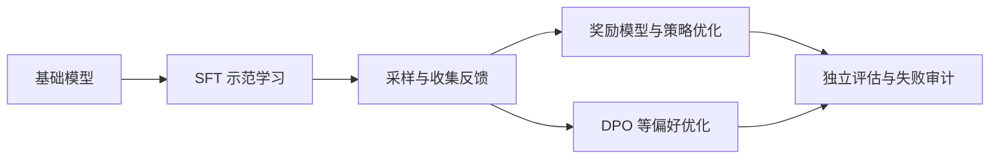

# L15｜后训练：从模仿示范到优化偏好

> Spring 2026 · 中文教材（含 Transcript 对照补遗）。主要依据用户提供的 `lecture-15.txt`，并结合[官方 PDF](https://github.com/stanford-cs336/lectures/blob/de53a9f979a6ee35f7d13a5e1aadee5ea1afc58e/lecture_15.pdf)。 时间定位：00:05–约 40:01 SFT 与 mid-training；45:00–65:02 偏好数据；70:00–79:46 DPO 与副作用。 课件重点页：6–30、32–50、53–64（PDF 页码从 1 开始）。正文按知识逻辑重组，不是逐字翻译；“补充理解”与教学算例为作者解释。未逐句对照录音。

## 1. Base model 为什么还不够像助手

预训练模型学习文档续写。给它一句问题，它可能回答，也可能继续补写问题、生成论坛里的其他回复或接出相关段落。助手需要更明确的行为：理解角色、遵循指令、使用工具、在不知道时承认不确定。

SFT 把模型带向示范的条件分布；偏好优化让模型提高更受认可的回答的相对概率。二者都依赖基础模型已有能力，也都可能产生新的适应，不能绝对地说“SFT 只解锁能力，永远不学新东西”。

图中两条偏好优化分支是不同路线，不要求依次全部执行。

## 2. SFT 的目标与 mask

对 prompt x 和示范回答 y，常用损失为：

$$
L_{SFT}=-\sum_{t\in\mathrm{assistant\ tokens}}\log\pi_\theta(y_t\mid x,y_{<t}).
$$

实际需要定义按 token、按样本还是按对话归一化，哪些角色参与损失，以及工具返回内容是否作为预测目标。相同聊天文本，mask 不同就对应不同学习任务。

教学例子：用户问算术题，助手调用计算器，工具返回结果，再由助手解释。模型需要学会“何时发起工具调用”和“如何读工具结果”，通常不应把工具真实执行过程当成模型本身必须生成的内容。

## 3. 一条示范同时教很多东西

一篇回答包含事实、结构、语气、长度、引用方式和拒答边界。训练并不会只学习你认为最重要的部分。若数据总包含漂亮但未经核验的参考文献，模型可能更擅长输出“像引用”的文本，却没有变得更会核实来源。

课堂用多个指令数据集对比：早期任务式问答、聊天式回答、长解释、工具轨迹，其风格与目标不同。偏好指标可能强烈偏好更长、有条列的答案，这不等于事实正确性同步提高。

**补充理解：** 示范像一份多维度合同。你以为自己只在教“回答问题”，模型却同时收到“回答应该多长、应该多自信、是否必须引用”的监督。

## 4. 知识、诚实与安全行为

在尾部事实上大量监督，可能让模型学到“遇到这类问题就自信补出一个答案”，而非稳定掌握可迁移知识。应检查数据是否提供足够支持，区分知识学习、知识提取和不确定性表达。

安全数据同样需要平衡：减少有害输出时，要检查是否错误拒绝正常请求。一个单独的拒答率无法同时衡量安全与有用性，需要按风险类型和正常任务分别评估。

## 5. Mid-training 为什么放在两者之间

从广泛预训练直接跳到很小的高质量 SFT 数据，分布变化可能过大。Mid-training 可以混合领域、代码、数学或指令相关数据，逐步调整能力与风格，再做更短、更针对性的后训练。

混合比例与顺序仍需要消融。有些能力提高，另一些可能遗忘；不能只报告目标 benchmark，而忽略通用能力和校准变化。

## 6. 为什么“写出好答案”与“挑出好答案”不同

人可能不擅长自己写一篇最佳摘要，却能在两个摘要间做出稳定选择。偏好数据利用了这种生成与判断能力的差距。

收集成对回答时，要随机展示顺序，写清 rubric，记录题目与回答来源，抽检标注者是否真正判断正确性。偏好反映的是某一群体和规则下的选择，并非普遍真理；评审模型也会继承长度、风格和来源偏见。

## 7. 从偏好训练奖励模型

若 chosen 为 y⁺、rejected 为 y⁻，常用 Bradley-Terry 假设：

$$
P(y^+\succ y^-\mid x)=\sigma(r_\phi(x,y^+)-r_\phi(x,y^-)).
$$

最大化这类比较的对数似然即可训练奖励模型。比较主要约束奖励差，不会自动给绝对分值赋予统一含义。标签噪声、偏好矛盾和覆盖不足，都可能影响外推。

随后优化策略时，常加入参考策略的 KL 约束：

$$
\max_\pi\;\mathbb{E}_{y\sim\pi}[r(x,y)]-\beta D_{KL}(\pi(\cdot|x)\Vert\pi_{ref}(\cdot|x)).
$$

它限制策略为了高奖励而过度偏离参考行为，但 β 的实际影响取决于奖励尺度和优化实现。

## 8. DPO 的推导为什么能省掉显式奖励模型

在不限策略函数空间的理想情形，前面的目标最优解满足：

$$
\pi^*(y|x)\propto\pi_{ref}(y|x)\exp(r(x,y)/\beta).
$$

移项可把奖励写成 β·log(π/π_ref) 加一个只依赖 x 的常数。成对比较时该常数抵消，得到 DPO 损失：

$$
L_{DPO}=-\log\sigma\left(\beta\left[\log\frac{\pi_\theta(y^+|x)}{\pi_{ref}(y^+|x)}-\log\frac{\pi_\theta(y^-|x)}{\pi_{ref}(y^-|x)}\right]\right).
$$

直觉是提高被选回答相对于参考模型的优势，压低被拒回答的相对优势。实现中仍需正确计算 response token 的序列 log-prob 与 mask；替换为长度平均会改变目标，不是纯粹数值实现细节。

这套推导依赖理想化假设与偏好模型，不能因此保证有限神经网络、有限离线数据下等价于任何 PPO 运行。标准离线 DPO 不需要当前策略 rollout，但迭代收集新数据后再做 DPO 可以形成外循环。

## 9. 奖励越高，为何可能越不好

策略可能利用奖励模型的盲点：生成更长文本、迎合评审、重复高分模式。奖励提高而人工质量下降，就是过度优化的警讯。还可能发生分布收缩和熵降低，影响多样性或概率校准。

需要用未参与奖励构建的评估、人工抽查和固定任务回归约束结论。奖励曲线是训练信号，不是产品质量的唯一证明。

## 深入算例与补充理解

### 一个 DPO 样本的数值解释

设当前策略对 chosen 和 rejected 的序列 log-prob 分别为 −4、−5，参考策略分别为 −5、−5。那么 chosen 的相对提升是 1，rejected 是 0，DPO margin 为 β。

若 β=0.1，偏好预测概率为 sigmoid(0.1)≈0.525；若当前策略进一步提高 chosen 的相对优势，损失会下降。但同一个 β 的意义仍受概率口径、回答长度与数据影响，不能从一个玩具例子推出通用最佳值。

这个式子也说明 DPO 并不要求 chosen 的绝对概率在任何时候都上升；它主要约束两者相对于参考的差异，参数共享和其他样本还会影响实际概率变化。

### 为什么只保留 chosen 不是相同目标

SFT 只在 chosen 上学习，无法直接知道另一个看似合理的回答为什么更差。成对比较提供了局部对比信息：长度、正确性、语气或具体细节导致偏好差异。

但如果 pair 的两个回答差得太远，例如一个完全乱码，一个正常，学习信号未必集中于我们真正关心的高水平判断。数据难度、负样本生成方式和任务覆盖，可能与算法选择同样重要。

### 标注者差异不是纯噪声

有人更喜欢简洁，有人更喜欢详细；专家可能发现非专家漏掉的错误。把所有差异平均成一个标签，会掩盖偏好结构。应先明确产品服务谁、什么任务中需要什么标准，再决定如何处理分歧。

同样的原则适用于 AI 评审：把某个评审模型当作自动规则，并不能消除价值与质量标准的选择。评审一致性高是一个条件，和目标用户一致是另一个条件。

### SFT／DPO 实现检查清单的用途

这里的检查不是替代推导，而是把目标落实到数组：prompt token 是否被错误计入损失？padding 是否排除？chosen/rejected 是否共用同一 prompt？参考模型是否固定？序列 log-prob 是否与生成条件一致？训练与推理聊天模板是否相同？

这些问题会产生看起来像“算法不稳定”或“模型突然退化”的现象。先用一个小 pair 手算 log-prob 和 margin，再检查 batch 归约，通常比立即调整学习率更有效。

## 10. 自测

- chosen/rejected 的长度差异可能怎样影响序列 log-prob 和偏好目标？
- DPO 为什么包含参考模型，而不是只增加 chosen 概率？
- 安全拒答率提高时，还应检查哪类错误？
- 为何“奖励预测准确”与“优化奖励后策略可靠”是不同的问题？

**参考思路：** 优化会主动寻找代理指标的薄弱区域；离线分布上的准确性不能完全约束策略移出分布后的行为。

## Transcript 对照补遗

### SFT 数据的演化与“知道自己不知道”（00:00–约 42:00）

课堂不是只讲 loss：FLAN 把传统任务改成指令，但旧任务的输入格式与答案质量可能不自然；Self-Instruct、Alpaca/Vicuna 类路线用模型响应构造更自然的聊天监督；OpenAssistant 强调人工高质量；后来的合成数据进一步扩展到工具调用、规划和交互轨迹。数据从简短答案转向更详细、有人格/风格和可操作结构的示范，这些选择都会改变最终产品。

高质量少量 SFT 能显著调整一个强预训练模型的行为，不等于越少越好，也不证明只能“解锁”而不能学习知识。课堂用长尾事实和参考文献说明：一个正确示范同时教事实与“必须像这样引用”的格式，后者可能迁移到模型不知道的内容上，诱发编造。On-policy 奖励可能帮助把内部不确定性关联到输出选择，但若内部没有相关信号或奖励本身错误，也不会自动得到诚实校准。

安全调优需同时测有害请求放行和正常请求误拒，例如“终止 Python 进程”不该因词面被拒。课堂介绍从真实使用中发现失败、构造拒答/抵抗样本的路线；少量数据能改变某类行为不代表边界已全面覆盖。Mid-training 在衰减末段混入高质量/指令数据，使“base model”标签越来越不代表纯网页续写；课堂例子中的纯预训练损失也会预测 query，而不同 SFT 配方可采用不同 mask。

### 偏好数据为何占据半讲（约 42:00–65:00）

SFT 是拟合示范条件分布；奖励优化是选择能获得高奖励的策略。后者允许分布收缩成少数高奖励回答，所以“质量提高”与“生成分布更丰富”不能混为一谈。

人工标注质量不仅看学历或工资，还要看任务知识、检查时间、可执行 rubric、是否真的验证事实以及标注分布。高 inter-annotator agreement 说明一致性，不能排除所有人共享同一种偏差。大众偏好可能更容易识别文风，专家才能核查专业细节；群体差异和隐蔽风格也可能经数据传递。课堂中的群体调查与潜移默化现象是具体研究例子，不据此给人口群体贴统一标签。

模型标注具有成本与扩展优势，适合追赶已有强模型；若目标是超越老师或获取新的现实专业信息，仍需要外部反馈与验证。Constitutional AI 式自我批评/改写是数据循环的另一种形式，不自动增加外部事实。人工和模型裁判都可能偏好长回答，不能只追求 win rate。

### 从策略梯度到 DPO 的课堂桥梁（约 65:00–结尾）

最基本策略梯度为 `E[r(y)∇logπ(y|x)]`；用旧 rollout 多做更新需要处理策略分布变化。PPO 的 clipping 约束当前策略相对采样策略的更新，而 KL 到参考策略约束偏离初始/参考行为，这两种约束不应混同。课堂先概述这一动机，再转向避免显式在线优化环节的 DPO，并未完整推导 PPO；下一讲才展开。

“正例 SFT、负例反向 SFT”的直觉不足以定义 DPO，真正的损失还有参考 log-ratio 与依偏好 margin 变化的权重；也不能保证某个 chosen 的绝对概率每步都增加。迭代 DPO 可重采样偏好对；SimPO、长度归一化等改变目标或假设，不是所有配置上必然更好。课堂强调算法排序对数据与调参敏感。

RLHF 过度优化可能提高奖励模型分数却降低真实质量，带来熵下降、多样性减少或校准变化；KL 是控制手段，不能作为不退化的证明。本讲字幕有较多断句，残缺的访谈细节和问答需另回听；以上补足其可读的技术与数据主线。

---

[返回教材目录](README.md) · [材料与编写说明](../sources/textbook-evidence.md)

[上一讲：L14](14-data-processing.md) · [下一讲：L16](16-rlvr-grpo.md)
