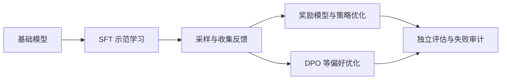

# L15｜后训练：从模仿示范到优化偏好

本章只需要基本 Python、矩阵运算和概率/求导知识，新的术语会在使用时解释。我们先讲 SFT 数据的演化、风格、知识与安全，再简述监督训练和 mid-training；随后用同样的“先数据、后算法”顺序展开 RLHF，最后讨论过度优化。

## 1. Base model 为什么还不够像助手

基础语言模型根据前文预测下一 token，token 是文本切分单位。策略 π_θ(y|x) 是参数为 θ 的模型在 prompt x 后生成回答 y 的条件概率；并不是一个单独装在模型外面的规则表。预训练拟合广泛文档，后训练希望把这些能力转成更合用的行为。监督微调（SFT）使用示范回答，人类反馈强化学习（RLHF）使用人类偏好形成的反馈；直接偏好优化（DPO）是后文将介绍的一条离线偏好学习路线。

预训练模型学习文档续写。给它一句问题，它可能回答，也可能继续补写问题、生成论坛里的其他回复或接出相关段落。助手需要更明确的行为：理解角色、遵循指令、使用工具、在不知道时承认不确定。

SFT 把模型带向示范的条件分布；偏好优化让模型提高更受认可的回答的相对概率。二者都依赖基础模型已有能力，也都可能产生新的适应，不能绝对地说“SFT 只解锁能力，永远不学新东西”。

图中两条偏好优化分支是不同路线，不要求依次全部执行。

## 2. 一条示范同时教很多东西

一条 SFT 数据是输入 x 与示范回答 y。监督学习不断提高这些回答在对应条件下的概率，但同时学到内容、格式、语气和引用方式。数据自然与否、是否有工具轨迹、由谁撰写，都在规定模型练习哪种行为，不能只把它看成一行正确标签。

一篇回答包含事实、结构、语气、长度、引用方式和拒答边界。训练并不会只学习你认为最重要的部分。若数据总包含漂亮但未经核验的参考文献，模型可能更擅长输出“像引用”的文本，却没有变得更会核实来源。

用多个指令数据集对比：早期任务式问答、聊天式回答、长解释、工具轨迹，其风格与目标不同。偏好指标可能强烈偏好更长、有条列的答案，这不等于事实正确性同步提高。

**补充理解：** 示范像一份多维度合同。你以为自己只在教“回答问题”，模型却同时收到“回答应该多长、应该多自信、是否必须引用”的监督。

### SFT 数据的演化与“知道自己不知道”

SFT 的效果不仅取决于 loss：FLAN 把传统任务改成指令，但旧任务的输入格式与答案质量可能不自然；Self-Instruct、Alpaca/Vicuna 类路线用模型响应构造更自然的聊天监督；OpenAssistant 强调人工高质量；后来的合成数据进一步扩展到工具调用、规划和交互轨迹。数据从简短答案转向更详细、有人格/风格和可操作结构的示范，这些选择都会改变最终产品。

### 示例正确性、标注方式与人口调查的边界

先看一个简单的数据校验：`[4,3,6,10,8]` 总和为 31，平均数应为 **6.2**。如果示范回答写成 6.4，语气再自然也会给模型错误监督。工具调用、待办列表与文件读取轨迹还要检查协议和行为顺序：训练数据中出现一条指令，是在定义要模仿的行为样本，并不自动代表该行为正确。

分析 SFT 收益时，要分别检查数据风格、评审偏好与任务能力。输入/输出长度反映风格，长文本与列表可能获得额外偏好，但不同训练数据也会影响实际任务表现，不能把所有提升都归于文风。另一些知识实验发现，学习未知事实时可能伴随验证集退化；这提示要检查数据与泛化，却不能证明 SFT 永远学不会新知识。

## 3. 知识、诚实与安全行为

“模型知道”在这里是研究与产品上的操作概念，没有一个通用开关直接读出全部知识。训练要求它输出未知细节，可能同时强化自信引用的模板。诚实与安全也不同：事实是否可靠、是否承认不确定、是否应拒答，需要不同评价。false refusal 是误拒正常请求，不是越低越好或越高越好的一维目标。

在长尾事实上大量监督，可能让模型学到“遇到这类问题就自信补出一个答案”，而非稳定掌握可迁移知识。应检查数据是否提供足够支持，区分知识学习、知识提取和不确定性表达。

安全数据同样需要平衡：减少有害输出时，要检查是否错误拒绝正常请求。一个单独的拒答率无法同时衡量安全与有用性，需要按风险类型和正常任务分别评估。

高质量少量 SFT 能显著调整一个强预训练模型的行为，不等于越少越好，也不证明只能“解锁”而不能学习知识。用长尾事实和参考文献说明：一个正确示范同时教事实与“必须像这样引用”的格式，后者可能迁移到模型不知道的内容上，诱发编造。On-policy 奖励可能帮助把内部不确定性关联到输出选择，但若内部没有相关信号或奖励本身错误，也不会自动得到诚实校准。

安全调优需同时测有害请求放行和正常请求误拒，例如“终止 Python 进程”不该因词面被拒。可以从真实使用中发现失败，再构造拒答或抵抗样本；少量数据能改变某类行为不代表边界已全面覆盖。

比较安全调优时，应固定模型版本、数据与测试协议。约 500 个示例曾改变一组测试中的有害回答比例，但这个数量不是通用阈值；覆盖某种失败，也不表示已经覆盖全部边界。

## 4. SFT 的目标与 mask

对回答 y=(y₁,…,y_T)，自回归概率是各位置条件概率的乘积，log-prob 是它们的对数和。mask 指哪些位置计入损失；padding、用户 prompt、工具返回和助手 token 可采用不同规则。一个 token 的目标损失是 −logπ_θ(y_t|x,y_<t)，不是对模型抽样的另一答案打标签。

对 prompt x 和示范回答 y，常用损失为：

$$
L_{SFT}=-\sum_{t\in\mathrm{assistant\ tokens}}\log\pi_\theta(y_t\mid x,y_{<t}).
$$

实际需要定义按 token、按样本还是按对话归一化，哪些角色参与损失，以及工具返回内容是否作为预测目标。相同聊天文本，mask 不同就对应不同学习任务。

教学例子：用户问算术题，助手调用计算器，工具返回结果，再由助手解释。模型需要学会“何时发起工具调用”和“如何读工具结果”，通常不应把工具真实执行过程当成模型本身必须生成的内容。

## 5. Mid-training 为什么放在两者之间

mid-training 是在广泛预训练与更专门后训练之间，继续使用调整后的数据混合训练。衰减段指学习率在接近终点时降低的阶段；注入指令样本后，“base”未必仍只代表普通网页分布。应先说明实际数据与损失，再使用阶段标签。

从广泛预训练直接跳到很小的高质量 SFT 数据，分布变化可能过大。Mid-training 可以混合领域、代码、数学或指令相关数据，逐步调整能力与风格，再做更短、更针对性的后训练。

混合比例与顺序仍需要消融。有些能力提高，另一些可能遗忘；不能只报告目标 benchmark，而忽略通用能力和校准变化。

Mid-training 在衰减末段混入高质量/指令数据，使“base model”标签越来越不代表纯网页续写；纯预训练损失也会预测 query，而不同 SFT 配方可采用不同 mask。

短衰减分支允许低成本比较多种数据混合，再将结果反馈到预训练配比。这里仍有试错与领域权衡：小模型或短分支的排序未必跨规模、跨阶段不变。少量示例可以迅速改变行为，一种解释是它们激活了预训练已学到的能力；但单凭快速改善，还不能证明某种抽象行为在预训练中已完整存在。

## 6. 为什么“写出好答案”与“挑出好答案”不同

偏好数据通常固定同一输入，让标注者比较不同回答。chosen/rejected 表示被选与未选，不保证二者分别完全正确与完全错误。rubric 是具体评判标准；随机展示顺序、标注者任务知识、可用检查时间及分歧，都会改变最终信号。

人可能不擅长自己写一篇最佳摘要，却能在两个摘要间做出稳定选择。偏好数据利用了这种生成与判断能力的差距。标注应保存题目和回答来源并抽检是否真正核实内容；偏好对应特定人群与规则，不能当成普遍正确性标签。

### 偏好数据为何占据半讲

SFT 是拟合示范条件分布；奖励优化是选择能获得高奖励的策略。后者允许分布收缩成少数高奖励回答，所以“质量提高”与“生成分布更丰富”不能混为一谈。

人工标注质量不仅看学历或工资，还要看任务知识、检查时间、可执行 rubric、是否真的验证事实以及标注分布。高 inter-annotator agreement 说明一致性，不能排除所有人共享同一种偏差。大众偏好可能更容易识别文风，专家才能核查专业细节；群体差异和隐蔽风格也可能经数据传递。这些群体调查与潜移默化现象是具体研究例子，不据此给人口群体贴统一标签。

模型标注具有成本与扩展优势，适合追赶已有强模型；若目标是超越教师模型或获取新的现实专业信息，仍需要外部反馈与验证。Constitutional AI 式自我批评/改写是数据循环的另一种形式，不自动增加外部事实。人工和模型裁判都可能偏好长回答，不能只追求 win rate。

理解人工偏好数据时，要记录标注者来自哪里、如何招募、具有什么背景及获得怎样的报酬。单个平台的年龄、学历分布不能代表所有用户；模型回答与某个人口群体意见较接近，也不证明该群体有统一立场，更不能仅由相关性推出原因。

### 评审相关性、数据消融与生成判断差距

Generation–verification gap 指“能写出示范”与“能判断更好的输出”之间的差距。标注者对回答的偏好可能不同，不能假设人们一致认为某一类输出更好。收集数据时，也要区分二选一偏好与分级评分：前者给出相对排序，后者给出等级，噪声和转成训练目标的方式都不同。

模型裁判与人工裁判的一致性有两个层次：**系统级胜率排名**的相关性，以及单个样本判断的一致率。前者很高，不代表每一对输出都判断正确。比较非专家与专家时，还应按错误类型检查识别差异，避免用一个总排名遮住系统性的漏判。

## 7. 从偏好训练奖励模型

奖励模型 r_φ(x,y) 把回答映射为标量，φ 是它的参数。Bradley–Terry 假设以两个奖励之差预测偏好：σ(u)=1/(1+exp(−u))。优化策略时的期望 E_{y~π}[r]，是按策略会生成什么回答来平均，并不是只对离线数据算一个均值。

KL(π||π_ref)=Σ_y π(y|x)log[π(y|x)/π_ref(y|x)] 衡量偏离参考策略的程度；β 控制其相对权重。reference 常为监督模型，old policy 则是采集当前 rollout 的策略，二者职责不同。PPO clipping 限制相对 old 的更新，不能把它等同为固定参考 KL。

若 chosen 为 y⁺、rejected 为 y⁻，常用 Bradley-Terry 假设：

$$
P(y^+\succ y^-\mid x)=\sigma(r_\phi(x,y^+)-r_\phi(x,y^-)).
$$

最大化这类比较的对数似然即可训练奖励模型。比较主要约束奖励差，不会自动给绝对分值赋予统一含义。标签噪声、偏好矛盾和覆盖不足，都可能影响外推。

随后优化策略时，常加入参考策略的 KL 约束：

$$
\max_\pi\;\mathbb{E}_{y\sim\pi}[r(x,y)]-\beta D_{KL}(\pi(\cdot|x)\Vert\pi_{ref}(\cdot|x)).
$$

它限制策略为了高奖励而过度偏离参考行为，但 β 的实际影响取决于奖励尺度和优化实现。

若用 PPO 来优化，还会出现另一个策略：**采集这批回答时的旧策略**。PPO 的概率比 `π_θ/π_old` 和 clipping 控制当前更新相对采样策略的变化；上式的 KL 则比较当前策略与参考策略，后者常是 SFT 模型。二者可能在最初相同，训练后却承担不同职责。复用一批 rollout 做若干轮更新，也不等于可以随意使用很久以前、概率条件不明的数据。

### 从策略梯度到 DPO

最基本策略梯度为 `E[r(y)∇logπ(y|x)]`；用旧 rollout 多做更新需要处理策略分布变化。PPO 的 clipping 约束当前策略相对采样策略的更新，而 KL 到参考策略约束偏离初始/参考行为，这两种约束不应混同。我们先概述这一动机，再转向避免显式在线优化环节的 DPO，并未完整推导 PPO；下一讲才展开。

### PPO、DPO 与过度优化实验

PPO 的 clipping 约束相对 **rollout 采样策略**的概率比；KL 正则通常约束相对 **SFT/reference 策略**的偏离。两者的参照和作用不同。PPO 经常对刚采得的数据做多轮更新，但仍通常归类为 on-policy 算法，不能因为复用一个 batch 就等同于任意陈旧数据的离线 RL。PPO-ptx 额外混合预训练损失；这是该变体的设计，不是所有 PPO 的必备项。

## 8. DPO 的推导为什么能省掉显式奖励模型

DPO 把偏好似然与理想 KL 正则化最优策略的关系结合，使用策略相对参考的 log-ratio。推导里的不限函数空间最优解，不代表有限神经网络一定能达到它；离线内层不需要当前策略采样，也不代表外层永远不会重收集数据。

在不限策略函数空间的理想情形，前面的目标最优解满足：

$$
\pi^*(y|x)\propto\pi_{ref}(y|x)\exp(r(x,y)/\beta).
$$

移项可把奖励写成 β·log(π/π_ref) 加一个只依赖 x 的常数。成对比较时该常数抵消，得到 DPO 损失：

$$
L_{DPO}=-\log\sigma\left(\beta\left[\log\frac{\pi_\theta(y^+|x)}{\pi_{ref}(y^+|x)}-\log\frac{\pi_\theta(y^-|x)}{\pi_{ref}(y^-|x)}\right]\right).
$$

直觉是提高被选回答相对于参考模型的优势，压低被拒回答的相对优势。实现中仍需正确计算 response token 的序列 log-prob 与 mask；替换为长度平均会改变目标，不是纯粹数值实现细节。

这套推导依赖理想化假设与偏好模型，不能因此保证有限神经网络、有限离线数据下等价于任何 PPO 运行。标准离线 DPO 不需要当前策略 rollout，但迭代收集新数据后再做 DPO 可以形成外循环。

“正例 SFT、负例反向 SFT”的直觉不足以定义 DPO，真正的损失还有参考 log-ratio 与依偏好 margin 变化的权重；也不能保证某个 chosen 的绝对概率每步都增加。迭代 DPO 可重采样偏好对；SimPO、长度归一化等改变目标或假设，不是所有配置上必然更好。算法排序对数据与调参敏感。

DPO 推导需参考分布在讨论的输出上有支持、正则系数为正且归一化常数有限。指数倾斜形式是不限策略函数空间时的最优解；接着代入的是**成对偏好的似然模型**，并非把神经网络训练误差消除。梯度权重由隐式奖励差决定，不是仅比较 chosen/rejected 的原始概率。

SimPO 同时包含按长度归一化与目标 margin γ，并非仅删掉参考模型；length-normalized DPO 仍保留参考项，是另一个目标。DPO 还可放在重采样、拒绝采样与 SFT 的外循环中，“无需在线 rollout”只描述标准离线 DPO 内层。

## 9. 奖励越高，为何可能越不好

过度优化是策略主动寻找代理奖励的薄弱处：指标上升，独立质量却可能下降。mode collapse 指输出集中到较少模式；校准则问声称或隐含的置信程度是否与真实正确率一致。三者可能相关，但并非同一个统计量。

策略可能利用奖励模型的盲点：生成更长文本、迎合评审、重复高分模式。奖励提高而人工质量下降，就是过度优化的警讯。还可能发生分布收缩和熵降低，影响多样性或概率校准。

需要用未参与奖励构建的评估、人工抽查和固定任务回归约束结论。奖励曲线是训练信号，不是产品质量的唯一证明。

检查过度优化时，可以把代理奖励放在横轴、独立评价放在纵轴：如果奖励继续上升而独立评价先升后降，说明模型正在利用代理目标的局限。人工偏好和带噪合成偏好实验都可能出现这种走势；某个无噪声模拟裁判未出现，并不能证明所有 AI 奖励都免疫。温度调整可以改善特定评估中的校准，也不保证恢复所有任务与人群上的校准。RLHF 后模型仍定义概率分布，变化的是优化目标不再要求拟合原始数据分布。

## 深入算例与补充理解

### 一个 DPO 样本的数值解释

设当前策略对 chosen 和 rejected 的序列 log-prob 分别为 −4、−5，参考策略分别为 −5、−5。那么 chosen 的相对提升是 1，rejected 是 0，DPO margin 为 β。

若 β=0.1，偏好预测概率为 sigmoid(0.1)≈0.525；若当前策略进一步提高 chosen 的相对优势，损失会下降。但同一个 β 的意义仍受概率口径、回答长度与数据影响，不能从一个玩具例子推出通用最佳值。

这个式子也说明 DPO 并不要求 chosen 的绝对概率在任何时候都上升；它主要约束两者相对于参考的差异，参数共享和其他样本还会影响实际概率变化。

### 为什么只保留 chosen 不是相同目标

SFT 只在 chosen 上学习，无法直接知道另一个看似合理的回答为什么更差。成对比较提供了局部对比信息：长度、正确性、语气或具体细节导致偏好差异。

但如果 pair 的两个回答差得太远，例如一个完全乱码，一个正常，学习信号未必集中于我们真正关心的高水平判断。数据难度、负样本生成方式和任务覆盖，可能与算法选择同样重要。

### 标注者差异不是纯噪声

有人更喜欢简洁，有人更喜欢详细；专家可能发现非专家漏掉的错误。把所有差异平均成一个标签，会掩盖偏好结构。应先明确产品服务谁、什么任务中需要什么标准，再决定如何处理分歧。

同样的原则适用于 AI 评审：把某个评审模型当作自动规则，并不能消除价值与质量标准的选择。评审一致性高是一个条件，和目标用户一致是另一个条件。

### SFT／DPO 实现检查清单的用途

这里的检查不是替代推导，而是把目标落实到数组：prompt token 是否被错误计入损失？padding 是否排除？chosen/rejected 是否共用同一 prompt？参考模型是否固定？序列 log-prob 是否与生成条件一致？训练与推理聊天模板是否相同？

这些问题会产生看起来像“算法不稳定”或“模型突然退化”的现象。先用一个小 pair 手算 log-prob 和 margin，再检查 batch 归约，通常比立即调整学习率更有效。

## 独立完成一个小算例

当前策略对 chosen/rejected 的序列 log-prob 为 −4、−5，参考都是 −5。两者相对参考的差为 1 与 0，β=0.1 时 DPO margin=0.1，偏好概率 σ(0.1)≈0.525，损失 −ln(0.525)≈0.644。若 margin 已很大，单对样本的更新权重会减小；它不是不加区分地把所有正例都提高同样幅度。

## 10. 自测

- chosen/rejected 的长度差异可能怎样影响序列 log-prob 和偏好目标？
- DPO 为什么包含参考模型，而不是只增加 chosen 概率？
- 安全拒答率提高时，还应检查哪类错误？
- 为何“奖励预测准确”与“优化奖励后策略可靠”是不同的问题？

**参考思路：** 优化会主动寻找代理指标的薄弱区域；离线分布上的准确性不能完全约束策略移出分布后的行为。

### 逐题推理

1. 序列 log-prob 是 token 对数概率求和，长短差异会改变数值；长度平均等改动改变目标，不能默认只是数值技巧。
2. 参考项约束相对初始行为的变化；只在 chosen 上 SFT 没有同样的成对 margin 和参考约束。
3. 安全拒答率上升还要检查正常任务误拒、不同风险类别及使用条件；不能只报单一平均数。
4. 奖励模型在旧数据上准确，不足以约束策略刻意移向的区域。需要独立评估、人工抽查与训练回归。

参考资料：[CS336 Spring 2026 资料](https://github.com/stanford-cs336/lectures/blob/de53a9f979a6ee35f7d13a5e1aadee5ea1afc58e/lecture_15.pdf)

---

[返回教材目录](README.md) · [材料与编写说明](21-jiao-cai-cai-liao-yu-bian-xie-shuo-ming.md)

[上一讲：L14](15-l14-shu-ju-guan-xian-guolminhash-qu-zhong-hun-he-yu-he-cheng.md) · [下一讲：L16](17-l16rlvr-yu-grpo-zen-yang-cong-ke-yan-zheng-jie-guo-zhong-xue-xi.md)
