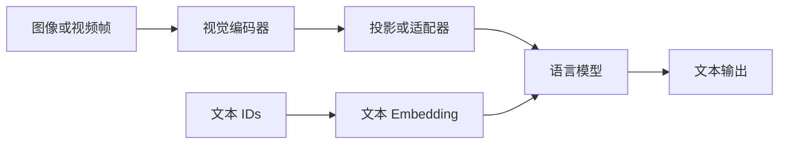

# L17｜多模态：怎样让语言模型看见图像与视频

> Spring 2026。以用户提供的完整 lecture-17.txt 为主线，按课堂讨论顺序展开。结合[同年官方讲义](https://github.com/stanford-cs336/lectures/blob/de53a9f979a6ee35f7d13a5e1aadee5ea1afc58e/lecture_17.py)核对公式、图表与代码。未逐句回听音频。

本章只预设基本 Python、矩阵运算和概率/求导知识；第一次用到的课程术语在正文解释。课堂从 CLIP 的配对学习与视觉编码开始，转到 SigLIP，再沿 LLaVA、AnyRes 和 Qwen 系列展开视觉语言模型，最后讨论统一理解与生成。

## 1. 语言模型的接口可以接收连续向量

语言模型把离散 token ID 查成向量，再处理一串隐藏向量；因此外部编码器产生的连续图像特征，也可通过接口变成这一序列的一部分。“视觉 token”在输入侧常指一个连续特征位置，不一定是输出词表里的离散 ID。

本章的 B 是 batch 内配对数，H/W 是图像高宽，p 是 patch 边长，d_v 是视觉特征宽度，d 是语言隐藏宽度。把这些维度分开，才能看清信息在哪一步被压缩。

文本 token 先查 embedding，再进入 Transformer；图像也可以先经过视觉编码器，变成一串连续特征，再投影到语言模型隐藏空间。这里的视觉 token 不一定是离散词表编号。

第一步要决定什么算一个视觉单位：patch、区域、帧，还是压缩后的表示。单位越细，可能保留更多小字与细节，也会增加序列长度和计算。问题与第一讲分词呼应，但图像的二维结构和信息密度更复杂。

这是典型理解型 VLM 的简图，图片生成还需要对应输出机制。

## 2. CLIP 学的是什么

图像编码器与文本编码器分别产生向量，L2 归一化是除以各自长度，使点积反映方向相近程度。温度 τ 控制相似度分布的尖锐程度。CLIP 的任务是从同批候选中认出对应配对，既做图到文，也做文到图；这和根据图片逐 token 生成回答不同。

对一批图像—文本配对，分别编码得到归一化特征 u_i、v_j，计算相似度 (s_{ij}=u_i^\top v_j/\tau)。对每张图，希望正确文本比其他文本得分更高，反过来也一样。

一个方向的目标为：

$$
L_{i\to t}=-\frac1B\sum_i\log\frac{\exp(s_{ii})}{\sum_j\exp(s_{ij})}.
$$

再加上文本到图像方向，形成对称对比学习。它把配对关系转成大规模监督，不要求每张图都有人工类别标签。但同一 batch 中的其他文本不一定真正无关，噪声与假负样本仍存在。

CLIP 可以把“某类别的照片”编码为文本向量，与图像比较做零样本分类。它不是一个能直接自由生成回答的聊天模型，也不保证保存所有细粒度 OCR 信息。

### CLIP/SigLIP 的课堂细节

本讲重点是多模态输入到文本输出，不能把它当成完整 omni 系统教程。CLIP 用两侧编码器和归一化相似度，在 batch 内做图到文、文到图两个方向的分类；网页配对文本并非完美描述图像，负例也可能语义相近，因此有噪声和假负例。相比只用图像增强，文本提供更高层语义监督。

### CLIP 的图像向量与 VLM 的视觉序列不同

CLIP 对比学习用归一化全局图像/文本向量组成 N×N 相似度矩阵，对行列各做一次分类；同批不同图片可能都有狗，因而“错配对”未必语义完全不相关，这是假负例与标注噪声，规模并不会在逻辑上消除它。零样本分类还需把候选类别变成文本描述，再按相似度选择，不是已经训练了 ImageNet 专用分类头。

讲义把 attention pooling 与 ViT 放在同一段，口述也混在一起。按 [CLIP 官方实现](https://github.com/openai/CLIP/blob/main/clip/model.py)，用全局均值作为 query 的 AttentionPool2d 属于 **ModifiedResNet** 分支；其 ViT 分支使用 class token 的最终状态并投影。二者不要拼成一个不存在的统一 encoder。224/336 是不同检查点和处理配置，不能要求所有 CLIP 都使用 336。

接入 LLaVA 的通常是**一串 patch 特征**，而非把 CLIP 对比学习的单个全局向量直接当整张图唯一输入。projector 只需输出 LM 可使用的连续表示，不要求恰好等于某个自然语言词的 embedding；“映射为文字 token”在这里是接口类比，不是离散词典查表。约 63–66 分钟问答说视觉编码器较小主要做局部处理，但 ViT 的自注意力仍能跨 patch 交互，不能据此写成它只看彼此独立的小块。

## 3. ViT 如何把图像变成序列

ViT 将图片切成小块，每块展平、线性投影为一个向量，再加入位置表示并通过 Transformer。若 H、W 均能被 p 整除，位置数为 (H/p)(W/p)，否则实际实现还需缩放、裁剪或填充。图像级 pooling 是汇总整图的一种方式，而 VLM 常保留多个空间位置。

将 H×W 图像分成 p×p patch，未考虑特殊 token 时，patch 数约为 `(H/p)*(W/p)`。每块的像素被投影为向量，加上位置相关表示后通过视觉 Transformer。

教学算例：336×336 图像、14×14 patch，得到 24×24=576 个 patch。若两个方向的分辨率都翻倍，patch 数变四倍；视觉编码器的全局自注意力若直接处理所有 patch，相关矩阵规模还可能增加到十六倍。

固定裁剪方便批处理，却可能切掉边缘文字。不能把图像“能输入”当成模型“看清了所有内容”。

图像 resize/crop 可能丢失边缘细节，ViT 把 patch 投影成向量并加入位置信息；图像级表示的 pooling 应区分编码器变体。课堂把 attention pooling 放在概述中，不能因此说 CLIP 所有 ViT 都采用同一 pooling：原始 ResNet 与 ViT 分支的汇聚设计不同。文本端常用 EOS 位置表示。Zero-shot 分类是把候选类别写成文本再比较图文相似度，不要求为每个下游类别重新训练一个分类头。

## 4. SigLIP 为什么改变损失

二元 logistic 配对损失将匹配标签记为 +1，不匹配为 −1。每对可独立计算 log(1+exp(−z·a))，但使用多少负例、如何归约，以及是否跨卡交换 embedding 仍会影响训练。取消全局 softmax 分母不等于 batch 大小和通信都消失。

CLIP 用整批 softmax 比较配对与其他候选，需要跨样本归一化。SigLIP 把图文配对判断改为二元 logistic 损失，减轻对全局 softmax 的依赖，提供不同的批量与分布式计算权衡。

把一对图文的标签写为 z_{ij}∈{−1,+1}，匹配对取 +1，其余取 −1；设相似度经过可学习的尺度和偏置后为 a_{ij}，单对损失为：

$$
\ell_{ij}=\log\left(1+\exp(-z_{ij}a_{ij})\right).
$$

正例希望 a 变大，负例希望 a 变小；每一对都不需要其他候选的 softmax 分母。不过，若一批 B 对数据的全部 B² 个组合都参与，每个正例会对应 B−1 个负例。改变 B、负例采样或最终归约方式，仍会改变训练目标中的样本构成和权重。因此“逐对计算”并不等于“batch 大小完全无关”。

这不表示整个训练完全不需要通信，也不表示负样本数量无关。应该分清目标函数的归一化依赖和实际多卡系统的数据交换。

SigLIP 把全局 softmax 分类改成配对 sigmoid 损失，正例与负例逐对计算，可分块或环状交换 embedding，减少对一次全局 softmax 归一化的依赖；不等于完全无需跨设备交换数据。Batch/负例采样仍影响训练，只是结构更灵活。课堂中的速度比较是论文设定，不能由设备代际或训练天数单独推出算法优越性。

### SigLIP 的独立配对目标与效率口径

SigLIP 对每对图文做 sigmoid 二分类，不需要 CLIP 的全批 softmax 归一化；这方便分块计算，但仍需决定负例采样、正负比例、bias 与缩放。若直接使用一个 N×N 矩阵，N 个正例与 N(N−1) 个负例的比例会随 N 变，不能因此声称任意改 batch 都完全是相同目标。Batch=1 时没有批内错配负例；小 batch 与“绝对不能训练”也不是同一个结论。

[SigLIP 论文](https://arxiv.org/abs/2303.15343)比较过 32 TPUv4 **chips** 与先前 256 TPUv3 **cores** 的运行实例；芯片/核心、初始化、目标质量和数据预算都需对齐，不能只拿天数相除就归因于损失函数，更不能把课堂“v4 更慢”的一句话当成所有规格的硬件结论。

## 5. LLaVA：视觉编码器 + projector + LM

projector 是把每个 d_v 维视觉特征映射成 d 维语言输入的适配器；它负责接口，却不能恢复视觉编码器已经丢失的细节。冻结表示不更新该部分参数，解冻则允许其通过任务损失改变，训练阶段的定义必须具体到模块。

视觉编码器输出 patch 特征，projector 将其维度与分布对齐到语言模型，然后与文本一起输入。早期 LLaVA 先冻结两端、训练投影，再训练投影与语言模型；后续模型的冻结策略各有不同。

projector 可以先看成“接口适配器”。它让视觉特征成为语言模型可利用的上下文，但不能凭空补回编码器丢掉的小字，也不能完全代替图像问答数据。

指令数据可以来自图像对应的描述、对象信息和教师生成的问答。教师没有真实看见的细节，不应被当作可靠监督。数据生成方式决定模型练习了哪些视觉关系。

### 视觉语言模型演进不只是“接一个 projector”

LLaVA 的早期数据用已有图像标注/框/描述，请文本模型生成问答与解释；老师未必直接看到图像，所以可能继承标注遗漏或合成偏差。常见两阶段先冻结视觉与语言模型，只学映射，再进行指令阶段适配；后续版本扩大数据、模型和训练阶段，冻结策略也变化，不能一概写死。

## 6. 高分辨率、视频与动态长度

高分辨率可保留小字，却增加 patch 与注意力成本。AnyRes 以整体缩略图和局部裁剪结合，动态分辨率则让输入形状和视觉位置数随图变化。视频另有时间顺序；抽帧频率、时间标记、帧间 patch 合并和空间位置并不等价。

AnyRes 类方法保留缩略全图，再编码局部裁剪。这样同时提供整体布局和细节，但要记录裁剪位置，并控制视觉 token 总量。多图和视频可能采用更低的每图分辨率，避免一种模态占满上下文。

视频还引入时间轴。帧采样越稀，越容易漏掉短暂事件；采样越密，成本越大且存在大量重复。MRoPE 等方法分别表达时间、高度和宽度；显式时间戳又提供另一类时间信息。

**补充理解：** 把视频当成图片列表，就像把书只看成散页。每帧的内容重要，事件次序、持续时间和跨帧同一对象也重要。

AnyRes 将全局缩略图与局部高分辨率 crop 结合；单图、多图、视频分配不同 token 预算，防止重复帧占尽上下文。其消融还关心训练时单图学到的技能能否迁移到多图、视频和视觉提示，并非只展示某个 OCR 分数。

Qwen-VL 早期包含位置感知的 resampler/adapter、图像/框/引用等结构标记和分阶段训练；Qwen2-VL 引入动态分辨率、视觉 token 压缩及时间/高度/宽度的 M-RoPE。不同版本需分别记录，不能把名字不同的训练阶段当成完全相同流程。

### 动态分辨率、位置与多阶段训练

LLaVA 的线性/MLP 连接器、Qwen-VL 固定长度 cross-attention 连接器与后来的动态视觉序列是不同配置。模型训练不同阶段冻结哪些模块也不同：不能把 LLaVA 初版的“只训 projector”套到 Qwen-VL 的所有阶段。AnyRes 的核心是全局图加局部高分辨率视野，并控制视觉 token 预算；它和 Qwen2-VL 的原生动态分辨率在目的上相近，不能因此称实现完全相同。

按 [Qwen2-VL 论文](https://arxiv.org/html/2409.12191v2)，224×224、patch=14 得到 16×16=256 个 patch，2×2 合并后为 **64 个视觉 token**，再加 vision_start / vision_end 才是 **66**。论文还使用时间深度为 2 的视频 patch 处理；视频不能总按每帧完全独立算 token。讲义初始化写 DFN，口述回指 OpenCLIP 时不能抹去这一来源差别。

MRoPE 的时间、高度、宽度对应不同坐标；文本可用相同坐标退化为一维位置。Qwen3-VL 把频率分配交错，使不同轴覆盖不同频段，并加入显式时间戳供文本引用；这些不是在说图像内容内积只由位置决定。DeepStack 注入多层视觉特征，与简单输入层拼接不同。课堂对平方根长度归一化的具体实现明确带有不确定性：教材仅保留“平衡长短样本贡献”的动机，不据口述还原唯一精确 loss 代码。

## 7. 多模态训练为什么要平衡损失

若对所有有效 token 直接平均，长视频样本会贡献更多 token；逐样本平均或次线性长度加权会改变模态的相对训练权重。所谓“平衡损失”应写出样本长度、mask 与分母，而不能只说视频太长所以乘或除一个平方根。

视频样本往往很长，如果简单对所有 token 等权，它可能占据过多梯度预算。按样本、token 或长度缩放，都会改变模态权重。训练阶段还会逐渐提高上下文长度、解冻更多组件，并混合文本数据以维持语言能力。

Qwen-VL 系列、LLaVA 系列体现了不同分辨率、融合位置和数据配方；它们不应该被压成一条“先训练视觉再训练语言”的统一步骤。具体策略应回到对应版本材料。

Qwen3-VL 类变化包括交错分配各坐标的 RoPE 频率、显式视频时间戳，以及 DeepStack 将不同视觉层的表示注入多个语言层，不再只通过单个入口。长视频与短文本的损失重加权还可采用按长度的次线性权重等方案；具体“平方根”应结合原实现的归约分母，不能仅凭字幕半句决定乘还是除。解码/抽帧/数据加载也可能成为系统瓶颈，需与设备计算异步配合。

## 8. 看图回答与生成图片是不同方向

离散码本是一组可选向量；图像编码器的连续输出找到码本条目后，用条目 ID 表示，再由解码器恢复图像。码本大小回答有多少种符号，序列长度回答一张图用多少位置，它们不同。连续理解特征与生成像素所需信息也不同，不能假定一个编码器天然可逆。

连续视觉特征易于作为输入，但自回归输出通常需要可预测的离散符号。VQ-VAE 用码本把图像编码离散化，再由解码器恢复；Chameleon 等路线让文本与图像 token 一起建模。

代价是离散瓶颈可能丢失细节，多模态 token 的统计尺度也不同，训练可能出现归一化与 logit 稳定性问题。另一条路线为理解使用连续表示、生成使用专门的生成解码器，例如扩散组件。

课堂对未公开闭源系统的组成有推测，本教材不把这种推测写成已知架构事实。理解与生成所需信息不同，是可以独立思考的设计问题。

### Chameleon 与理解/生成的不对称

VQ 编码器先输出连续表示，再用 codebook 最近项量化成离散 ID，解码器重建图像；因最近项选择不可微，完整训练还需对应的梯度估计和辅助目标，不能只用一句普通 reconstruction loss 掩盖。课堂举例把图像变为约 1024 个、词表约 8k 的视觉 token，是特定配置。

Attention 的 Query/Key 是用于向量匹配的两种投影；QK norm 对它们作归一化以控制匹配分数尺度。统一离散 token 使文本与图像能交错自回归生成，但图像 token 的统计/熵和文本不同，可能引起 logit/norm 增长等不稳定，需要 QK norm 等措施。离散化又可能损失 OCR 所需细节。连续视觉编码器适合理解高层语义，生成则需重建精细外观，后者可以采用独立生成头或扩散路径；没有理由仅因接口优雅就认定一种编码对两种目标都最优。

### 离散码本与生成的边界

Chameleon 的 1024 指 512×512 图像的表示长度，8192 指码本可选项数，二者不可混为词表大小。最近邻量化不直接可微，训练除重建外还涉及量化相关项/梯度处理；仅写重建 loss 不足以复现。重新训练文本 BPE 与使用图像离散码是两套 token 来源，并非对图像像素执行文本 BPE。

这条路线能交错生成文本与图像，前面理解型 VLM 通常只输出文本；扩散头是另一种生成方案，不是所有连续编码器数学上只能接扩散。课堂末尾对未公开 omni 模型“可能连续编码+扩散”的说法明确是教师猜测；视频信息密度、训练平衡和 OCR 信息损失也应按任务与表示条件讨论，不据此断言所有视频都比所有文本信息少。

## 深入算例与补充理解

### 图像描述为什么不是图像本身

一张街景图的 caption 可能只写“路边停着一辆车”，遗漏车牌、颜色、标志牌和远处行人。若教师仅依据 caption 生成问答，它无法可靠回答图像中未被描述的信息。合成问答的可验证范围受教师实际输入限制。

这说明多模态数据不能只看问答是否流畅。需要检查问答是否与图像一致，特别是数数、位置关系、OCR 和小物体。语言先验足够强时，模型甚至可能不看图也答对常见问题，掩盖视觉能力不足。

### 一条图文问答的形状链

假设视觉编码器输出 `[576,d_v]`，projector 是 `d_v→d`，得到 `[576,d]`。文本 embedding 若有 100 个位置，与视觉 token 按模板组合后，语言模型处理的有效输入长度可能是约 676，再加角色与边界标记。

如果模型同时处理九个裁剪，视觉位置数量可能大幅增加。某些结构会用 pooling、merge 或 resampler 压缩，再送入语言模型。做成本核算时应该使用压缩后的真实 token 数，而不是原始图像张数。

### OCR、语义与生成需要的特征不同

分类任务只要知道“这是一只狗”，可能不需要保留背景中每个字；OCR 要保存笔画级细节；图像生成则需要颜色、纹理与空间布局。对比学习优化出的语义表示，不一定是可逆的视觉编码。

因此“CLIP 很强”不等于它的特征足以重建原图。连续编码器、离散码本和扩散解码器各有不同目标，组合它们需要解释信息在哪一步被保留或丢失。

### 多模态评估也要拆分错误来源

若模型读错账单数字，可能是图像分辨率过低、裁剪漏掉信息、视觉编码器识别错误、语言模型推理错误，或最终答案格式错误。分别提高分辨率、提供人工 OCR、提供正确中间信息，可以帮助定位瓶颈。

视频任务还应检查时间采样：某个只出现 0.2 秒的动作，在每两秒取一帧时可能根本没被输入。模型没有看见与看见但不理解，需要完全不同的改进方案。

## 独立完成一个小算例

224×224 图像、14×14 patch 得到 256 个视觉位置；若每个 2×2 空间块合并，变成 64 个。若再加两个视觉起止标记，则总数为 66。位置数量改变的是语言侧的序列长度；标记是否由视觉编码器产生、是否共享词表，仍依具体模型模板确定。

## 9. 自测与最小实验

- 一张 224×448 图像按 14×14 patch 切分，不裁剪时有多少 patch？
- 为什么提高输入分辨率不一定提高所有任务效果？
- 视觉 token 是不是一定对应离散词表 ID？
- 一个模型能读图，却不能生成图像，这在架构上是否矛盾？

**参考思路：** 第一问为 16×32=512；细节、成本、训练分布与位置表示共同决定收益。输入编码器与输出生成器是不同模块。

### 逐题推理

1. 224×448、patch=14，整除时为 16×32=512 个 patch；若另有压缩或边界标记，还需继续数实际输入。
2. 分辨率增大可能保留细节，也增加成本或偏离训练分布；必须看任务与编码策略。
3. 输入视觉 token 可是连续向量，输出自回归图像 token 常是码本 ID，不能混称为一种对象。
4. 能理解图片只需输入接口，生成图片还需输出表示和解码器，所以二者在架构上并不矛盾。

---

[返回教材目录](README.md) · [材料与编写说明](21-jiao-cai-cai-liao-yu-bian-xie-shuo-ming.md)

[上一讲：L16](17-l16rlvr-yu-grpo-zen-yang-cong-ke-yan-zheng-jie-guo-zhong-xue-xi.md) · [下一讲：L18](19-l18daniel-selsam-jia-bin-ke-cai-liao-dai-bu.md)
