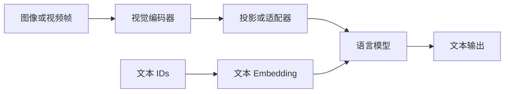

# 18 L17｜多模态：怎样让语言模型看见图像与视频

> Spring 2026 · 中文教材初版。主要依据用户提供的 `lecture-17.txt`，并结合[官方 课堂代码](https://github.com/stanford-cs336/lectures/blob/de53a9f979a6ee35f7d13a5e1aadee5ea1afc58e/lecture_17.py)。 时间定位：00:05–约 25:02 CLIP/SigLIP；30:02–60:00 VLM；65:00–77:29 统一生成。正文按知识逻辑重组，不是逐字翻译；“补充理解”与教学算例为作者解释。未逐句对照录音。

## 1. 语言模型的接口可以接收连续向量

文本 token 先查 embedding，再进入 Transformer；图像也可以先经过视觉编码器，变成一串连续特征，再投影到语言模型隐藏空间。这里的视觉 token 不一定是离散词表编号。

第一步要决定什么算一个视觉单位：patch、区域、帧，还是压缩后的表示。单位越细，可能保留更多小字与细节，也会增加序列长度和计算。问题与第一讲分词呼应，但图像的二维结构和信息密度更复杂。

这是典型理解型 VLM 的简图，图片生成还需要对应输出机制。

## 2. CLIP 学的是什么

对一批图像—文本配对，分别编码得到归一化特征 u\_i、v\_j，计算相似度 (s\_{ij}=u\_i^\top v\_j/\tau)。对每张图，希望正确文本比其他文本得分更高，反过来也一样。

一个方向的目标为：

$$
L_{i\to t}=-\frac1B\sum_i\log\frac{\exp(s_{ii})}{\sum_j\exp(s_{ij})}.
$$

再加上文本到图像方向，形成对称对比学习。它把配对关系转成大规模监督，不要求每张图都有人工类别标签。但同一 batch 中的其他文本不一定真正无关，噪声与假负样本仍存在。

CLIP 可以把“某类别的照片”编码为文本向量，与图像比较做零样本分类。它不是一个能直接自由生成回答的聊天模型，也不保证保存所有细粒度 OCR 信息。

## 3. ViT 如何把图像变成序列

将 H×W 图像分成 p×p patch，未考虑特殊 token 时，patch 数约为 `(H/p)*(W/p)`。每块的像素被投影为向量，加上位置相关表示后通过视觉 Transformer。

教学算例：336×336 图像、14×14 patch，得到 24×24=576 个 patch。若两个方向的分辨率都翻倍，patch 数变四倍；视觉编码器的全局自注意力若直接处理所有 patch，相关矩阵规模还可能增加到十六倍。

固定裁剪方便批处理，却可能切掉边缘文字。不能把图像“能输入”当成模型“看清了所有内容”。

## 4. SigLIP 为什么改变损失

CLIP 用整批 softmax 比较配对与其他候选，需要跨样本归一化。SigLIP 把图文配对判断改为二元 logistic 损失，减轻对全局 softmax 的依赖，提供不同的批量与分布式计算权衡。

这不表示整个训练完全不需要通信，也不表示负样本数量无关。应该分清目标函数的归一化依赖和实际多卡系统的数据交换。

## 5. LLaVA：视觉编码器 + projector + LM

视觉编码器输出 patch 特征，projector 将其维度与分布对齐到语言模型，然后与文本一起输入。早期 LLaVA 先冻结两端、训练投影，再训练投影与语言模型；后续模型的冻结策略各有不同。

projector 可以先看成“接口适配器”。它让视觉特征成为语言模型可利用的上下文，但不能凭空补回编码器丢掉的小字，也不能完全代替图像问答数据。

指令数据可以来自图像对应的描述、对象信息和教师生成的问答。教师没有真实看见的细节，不应被当作可靠监督。数据生成方式决定模型练习了哪些视觉关系。

## 6. 高分辨率、视频与动态长度

AnyRes 类方法保留缩略全图，再编码局部裁剪。这样同时提供整体布局和细节，但要记录裁剪位置，并控制视觉 token 总量。多图和视频可能采用更低的每图分辨率，避免一种模态占满上下文。

视频还引入时间轴。帧采样越稀，越容易漏掉短暂事件；采样越密，成本越大且存在大量重复。MRoPE 等方法分别表达时间、高度和宽度；显式时间戳又提供另一类时间信息。

**补充理解：** 把视频当成图片列表，就像把书只看成散页。每帧的内容重要，事件次序、持续时间和跨帧同一对象也重要。

## 7. 多模态训练为什么要平衡损失

视频样本往往很长，如果简单对所有 token 等权，它可能占据过多梯度预算。按样本、token 或长度缩放，都会改变模态权重。训练阶段还会逐渐提高上下文长度、解冻更多组件，并混合文本数据以维持语言能力。

Qwen-VL 系列、LLaVA 系列体现了不同分辨率、融合位置和数据配方；它们不应该被压成一条“先训练视觉再训练语言”的统一步骤。具体策略应回到对应版本材料。

## 8. 看图回答与生成图片是不同方向

连续视觉特征易于作为输入，但自回归输出通常需要可预测的离散符号。VQ-VAE 用码本把图像编码离散化，再由解码器恢复；Chameleon 等路线让文本与图像 token 一起建模。

代价是离散瓶颈可能丢失细节，多模态 token 的统计尺度也不同，训练可能出现归一化与 logit 稳定性问题。另一条路线为理解使用连续表示、生成使用专门的生成解码器，例如扩散组件。

课堂对未公开闭源系统的组成有推测，本教材不把这种推测写成已知架构事实。理解与生成所需信息不同，是可以独立思考的设计问题。

## 深入算例与补充理解

### 图像描述为什么不是图像本身

一张街景图的 caption 可能只写“路边停着一辆车”，遗漏车牌、颜色、标志牌和远处行人。若教师仅依据 caption 生成问答，它无法可靠回答图像中未被描述的信息。合成问答的可验证范围受教师实际输入限制。

这说明多模态数据不能只看问答是否流畅。需要检查问答是否与图像一致，特别是数数、位置关系、OCR 和小物体。语言先验足够强时，模型甚至可能不看图也答对常见问题，掩盖视觉能力不足。

### 一条图文问答的形状链

假设视觉编码器输出 `[576,d_v]`，projector 是 `d_v→d`，得到 `[576,d]`。文本 embedding 若有 100 个位置，与视觉 token 按模板组合后，语言模型处理的有效输入长度可能是约 676，再加角色与边界标记。

如果模型同时处理九个裁剪，视觉位置数量可能大幅增加。某些结构会用 pooling、merge 或 resampler 压缩，再送入语言模型。做成本核算时应该使用压缩后的真实 token 数，而不是原始图像张数。

### OCR、语义与生成需要的特征不同

分类任务只要知道“这是一只狗”，可能不需要保留背景中每个字；OCR 要保存笔画级细节；图像生成则需要颜色、纹理与空间布局。对比学习优化出的语义表示，不一定是可逆的视觉编码。

因此“CLIP 很强”不等于它的特征足以重建原图。连续编码器、离散码本和扩散解码器各有不同目标，组合它们需要解释信息在哪一步被保留或丢失。

### 多模态评估也要拆分错误来源

若模型读错账单数字，可能是图像分辨率过低、裁剪漏掉信息、视觉编码器识别错误、语言模型推理错误，或最终答案格式错误。分别提高分辨率、提供人工 OCR、提供正确中间信息，可以帮助定位瓶颈。

视频任务还应检查时间采样：某个只出现 0.2 秒的动作，在每两秒取一帧时可能根本没被输入。模型没有看见与看见但不理解，需要完全不同的改进方案。

## 9. 自测与最小实验

* 一张 224×448 图像按 14×14 patch 切分，不裁剪时有多少 patch？
* 为什么提高输入分辨率不一定提高所有任务效果？
* 视觉 token 是不是一定对应离散词表 ID？
* 一个模型能读图，却不能生成图像，这在架构上是否矛盾？

**参考思路：** 第一问为 16×32=512；细节、成本、训练分布与位置表示共同决定收益。输入编码器与输出生成器是不同模块。

***

[返回教材目录](00-cs336-spring-2026-zhu-jiang-zhong-wen-jiao-cai.md) · [材料与编写说明](21-jiao-cai-cai-liao-yu-bian-xie-shuo-ming.md)

[上一讲：L16](17-l16rlvr-yu-grpo-zen-yang-cong-ke-yan-zheng-jie-guo-zhong-xue-xi.md) · [下一讲：L18](19-l18daniel-selsam-jia-bin-ke-cai-liao-dai-bu.md)
